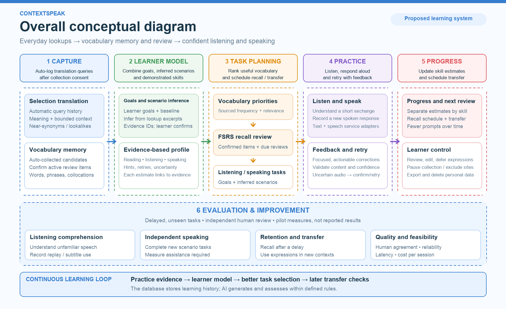

# ContextSpeak

**Build your vocabulary. Understand conversations. Speak with confidence.**

A browser extension and learning website that turns everyday English lookups into a personal vocabulary memory library, scheduled review, and contextual listening/speaking practice. The first release serves adults with basic English; broader language and school support follow later.

> Local developer slice implemented: fixture-backed capture → PostgreSQL history/candidates → website library. Not ready for public deployment.

## Run locally

Requires **Node.js 24** and **pnpm 11.25.0**. No Docker, paid API key, or hosted account is required; the launcher starts project-local PostgreSQL and a temporary signing-key issuer, all bound to loopback.

```bash
pnpm install
pnpm db:generate
pnpm build:extension
pnpm dev
```

1. Keep `pnpm dev` running. In a second terminal, run `pnpm demo:token` to copy learner A's one-hour developer token. Use `pnpm demo:token b` for an isolated second learner. Tokens rotate when the launcher restarts.
2. In Chrome, open `chrome://extensions`, enable Developer mode, choose **Load unpacked**, and select `apps/extension/.output/chrome-mv3` from this checkout.
3. Open the extension popup, paste the token, click **Connect**, enable automatic collection, and **Save collection settings**. Collection starts off.
4. Open [the library](http://127.0.0.1:3000/library), connect with the same token, then open [the selection playground](http://127.0.0.1:3000/sample.html).
5. Select **available**, release the mouse, and click **Translate selection**. Refresh the library to see the encounter and candidate. Repeat the query to add an encounter without duplicating the candidate.

Fixtures provide original English explanations for `available`, `reschedule`, `confident`, and `follow up` (English → English only). An unknown expression is saved but its translation shows `FIXTURE_NOT_FOUND`; no general translation is simulated. Full API keys and developer tokens never enter webpage scripts.

Stop with Ctrl+C. Local data stays in ignored `.local/postgres`; the extension queue survives restarts. Reconnect both clients after token expiry or launcher restart. If a query fails synchronization five times, inspect the popup and discard/re-query it. The local launcher reserves ports 3000, 4318, 4319, and 55432. `compose.yaml` is an optional database configuration, not needed by this launcher; do not run both databases on the same port.

## Verification

```bash
pnpm typecheck
pnpm test
pnpm exec playwright install chromium
pnpm test:e2e
pnpm build:web
```

`test:e2e` builds the extension and starts an isolated, disposable database and test issuer; stop `pnpm dev` first so the ports are free. It exercises a real unpacked extension in bundled Chromium, including duplicate delivery, separate users, missing fixtures, and offline browser restart. Integration tests use native project-local PostgreSQL, not an in-memory substitute. A manual installed-Chrome smoke check is still required before pilot.

## Capture and result behavior

- Local query writes finish before any synchronization request; slow/offline sync does not hold the storage lock.
- Collected queries create one stored translation result. The selection panel reads it through the owned result endpoint; the website shows the same persisted meaning. A failed result does not trigger a second translation as a fallback.
- When collection is off or the site is excluded, the explicit translation request uses the transient translation-only endpoint without writing query history.
- One sync runs at a time, processing at most 20 eligible records per batch; consent/site-exclusion cleanup covers all pending records independently of that limit. Acknowledgements merge by owner/event ID rather than overwriting a queue snapshot. Discard aborts in-flight requests and removes local records; it cannot undo a request already accepted by the server.
- The selection panel polls for a bounded period. Saved queries can finish later and remain available in the website; paid-provider retry/exactly-once billing guarantees are outside this fixture slice.

## Current boundary

Implemented: signed-token ownership checks, collection settings/site exclusions, canonical URL stripping, automatic lookup history, unresolved vocabulary candidates, bounded durable replay, fixture success/failure/retry, and a responsive library. Candidate listing currently shows the latest 100; review activation, FSRS, real login/pairing, lexical expansion, scenario inference, voice, export/deletion, and production operations are subsequent milestones. Do not expose the local developer issuer or credentials on a public network.

## System overview



[Editable SVG](docs/assets/conceptual-diagram.svg)

## Documentation

| Document | Purpose |
| --- | --- |
| [Planning](docs/PLANNING.md) | Requirements mapping, MVP, roadmap, costs, and decisions |
| [Methodology](docs/METHODOLOGY.md) | Collection, scenario inference, word priorities, and mastery evidence |
| [Architecture](docs/ARCHITECTURE.md) | Stack, translation/dictionary services, data flow, and safeguards |
| [First coding plan](docs/superpowers/plans/2026-11-07-capture-to-library.md) | A bounded capture-to-library implementation with checks |

## Working principles

- After collection consent, automatically record each selection-translation query and derive vocabulary candidates; activation for scheduled review requires confirmation.
- Combine learner goals, inferred scenarios, and separate reading/listening/speaking evidence.
- Build independently. [FluentRead](https://github.com/FluentRead/FluentRead) is a functional reference, not a source of copied code or assets. This is not a legal clearance statement.

A distribution license is undecided. The diagram adapts a user-supplied layout reference; its ownership/permission and the ContextSpeak brand still need clearance before public release.
