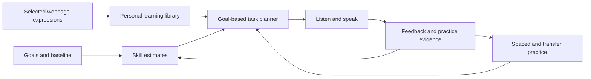

# ContextSpeak

**Turn everyday English encounters into confident conversations.**

ContextSpeak is a planned browser extension and learning website for adults who already know some English and want to understand spoken English and speak more fluently. It connects useful expressions encountered while browsing with personalized listening, speaking, and spaced practice.

中文简介：将日常阅读中遇到的英语表达，转化为个性化听说练习。面向有基础、希望听懂真实对话并流利交流的成人学习者。

> Status: product planning and architecture proposal. This repository currently contains documentation only; no application, infrastructure, or production service has been implemented.

## Product concept

1. Select an expression while browsing and receive a contextual explanation.
2. Save the expression, its specific meaning, and a minimal source excerpt.
3. Combine saved material with the learner's declared goals and practice evidence.
4. Complete short listening and spoken conversation tasks on the learning website.
5. Receive focused feedback, retry, and revisit the expression in a different situation later.

The product tracks reading recognition, listening comprehension, and independent spoken use separately. A lookup is a learning signal, not proof that someone does not know a word; a model-generated score is an estimate, not a certified proficiency result.

## Documentation

| Document | Contents |
| --- | --- |
| [Product and delivery plan](docs/PLANNING.md) | Audience, MVP requirements, acceptance criteria, milestones, risks, and unresolved decisions |
| [Learning methodology](docs/METHODOLOGY.md) | Task-based learning, evidence model, adaptive practice, scheduling, and evaluation |
| [Architecture design](docs/ARCHITECTURE.md) | Components, data model, APIs, synchronization, security, operations, and Mermaid diagrams |

## MVP scope

- Chrome extension: contextual selection translation, optional collection, minimal context capture, and retryable synchronization.
- Responsive learning website: goals, initial assessment, expression library, daily practice, and progress.
- Listening comprehension and turn-based recorded speaking tasks.
- Evidence-backed skill estimates and spaced review.
- User-controlled collection, export, and deletion.

Native mobile and desktop apps, school administration, continuous microphone capture, broad web crawling, full-duplex voice, and model training are outside the MVP.

## Proposed technology

| Area | Proposal |
| --- | --- |
| Language | TypeScript |
| Extension | WXT, React, Manifest V3 |
| Learning website | Next.js, React |
| Backend | NestJS modular monolith with separate workers |
| Primary data | PostgreSQL |
| Background work | Redis and BullMQ, with a transactional outbox |
| Audio | Private S3-compatible object storage |
| AI | Provider adapters for text generation, speech recognition, and speech synthesis |

These are proposed defaults, not finalized vendor commitments. Start with structured SQL retrieval and direct provider SDKs. Vector retrieval, LangChain, and separate Python services require a demonstrated need.

## Conceptual diagram

## Independent implementation

[FluentRead](https://github.com/FluentRead/FluentRead) is a product reference only. ContextSpeak is not a fork and does not include its source code, assets, branding, or copied interface. Any future third-party dependency or content must be reviewed for its own usage and licensing requirements.

## Next steps

Confirm the first scenarios, release geography, team capacity, operating budget, audio retention policy, and pilot success thresholds. Then validate a clickable workflow and speech feasibility before scaffolding the implementation.

No development commands are listed because no application has been scaffolded. A distribution license has not yet been selected.
