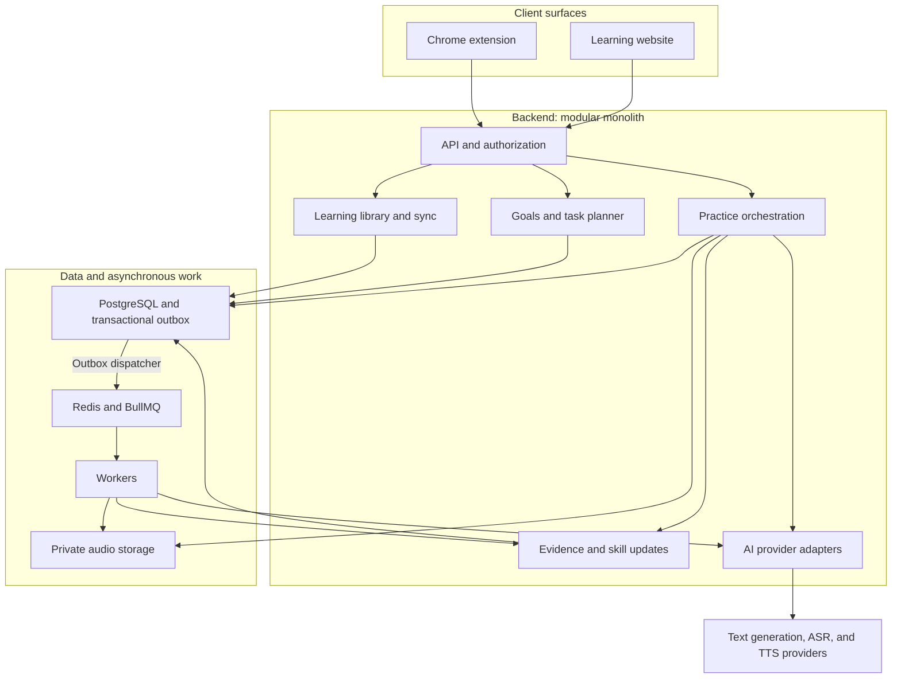
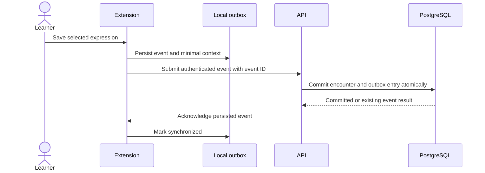
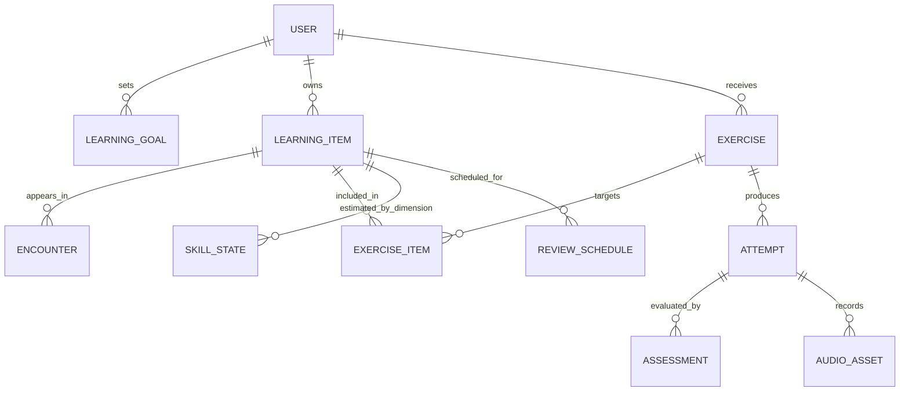

# ContextSpeak — Architecture design

Date: 2026-11-07
Status: proposed design. The diagrams describe intended behavior; no services or schemas have been deployed.

## 1. Scope and architecture choices

Build an independent Chrome extension and responsive learning website backed by a TypeScript modular monolith and separately runnable workers. PostgreSQL is the authoritative store for learning evidence and derived skill state. Models generate or assess constrained content; they do not own user identity, authorization, or durable memory.

### Approaches considered

| Approach | Benefit | Tradeoff | Position |
| --- | --- | --- | --- |
| Extend an existing translation project | Reuse existing translation infrastructure | Inherits design, complexity, and licensing obligations; conflicts with independent implementation preference | Not selected |
| Independent extension and website with modular backend | Fits confirmed surfaces; explicit data/learning rules; one backend to operate initially | Requires new capture, sync, and practice implementation | Proposed default |
| Native-app-first or microservices-first platform | Native device integration or independent scaling | Additional delivery/operational work before validating core behavior | Deferred |

The user selected extension + website and independent implementation. Specific frameworks remain recommendations pending implementation review.

## 2. Proposed stack and repository layout

WXT + React for the extension, Next.js + React for the website, NestJS for the API, PostgreSQL for relational data, Redis/BullMQ for work delivery, and private S3-compatible storage for audio. Use a pnpm workspace when implementation begins.

Proposed directories, not existing applications:

```text
apps/
  extension/          # WXT content UI, extension background, local outbox
  web/                # Next.js learning UI and recording experience
  api/                # NestJS HTTP API and domain modules
  worker/             # asynchronous generation, assessment, deletion
packages/
  contracts/          # versioned schemas and generated API types
  learning-core/      # pure scheduling and evidence-update rules
  ai-adapters/        # text, ASR, and TTS provider boundaries
  ui/                 # selected shared React primitives
docs/
```

Share contracts and pure logic rather than assuming every UI can be shared. Pin supported dependency versions and runtime versions during scaffolding; this document makes no claim about installed versions.

## 3. System diagram



Logical modules do not imply separately deployed microservices. Interactive calls are bounded synchronous requests or streamed responses; longer generation, assessment, cleanup, and retries use asynchronous jobs with visible status.

## 4. Module boundaries

| Module | Owns | Must not do |
| --- | --- | --- |
| Identity | Sessions, extension pairing, ownership context | Trust a client-supplied learner ID for authorization |
| Collection/library | Encounters, senses/expressions, edits, sync IDs | Capture whole browsing history or assume every lookup means ignorance |
| Planner | Goal selection, active-item budget, due tasks | Delegate unrestricted curriculum decisions to a model |
| Practice | Exercise versions, turns, hints, recordings, job state | Count answer-assisted retries as independent tests |
| Evidence | Rubrics, assessments, confidence, derived states | Overwrite raw practice records with unsupported model conclusions |
| Provider adapters | Request/response normalization, limits, timeouts, usage | Store credentials in the extension or bypass ownership checks |
| Data lifecycle | Exports, deletion, retention, backup expiry procedures | Allow late jobs to recreate deleted learner content |

## 5. Collection and synchronization

Use content scripts only on supported, permitted pages. Capture selected text, a bounded surrounding excerpt, and an optional sanitized source reference. Do not collect form fields, credentials, browser-restricted surfaces, or full browsing history. Strip query strings and fragments from stored URLs unless a future explicit requirement justifies them.

Save collection events to a durable extension-local outbox before upload. Each event has a client-generated ID and version. The server scopes idempotency by authenticated user and event ID. Acknowledge only after database commit; the client then marks the event synchronized. Use bounded retries and a visible pending state.

Chrome extension service workers can be suspended, so durable state must not live only in background-process memory. Handle unsupported pages and expired authentication explicitly.

### Capture sequence



If the response is lost, replaying the same event returns the persisted result. Candidate normalization can run later without delaying the initial translation explanation.

## 6. Core data model

| Entity | Important fields and purpose |
| --- | --- |
| User | Identity reference, locale, lifecycle status |
| LearningGoal | User, scenario interests, time budget, active dates |
| LearningItem | User, language, normalized expression, specific sense, provenance |
| Encounter | User/item, client event ID, minimal excerpt, sanitized source, timestamp |
| Exercise | User, scenario, target items, immutable content version, support conditions |
| Attempt | User/exercise, response reference, timing, hints, replays, retry parent |
| Assessment | Attempt, rubric/model versions, result, confidence, eligibility, reason codes |
| SkillState | User/item/dimension, estimate, confidence, rule version, last evidence |
| ReviewSchedule | User/item/task type, scheduler state, due time |
| AudioAsset | User, private object key, media metadata, retention/deletion status |
| OutboxEvent | Event ID, type, payload reference, dispatch state |
| UsageEvent | User/request, provider, metering, estimated cost; no raw private content |

Every user-owned relationship must preserve ownership in queries and constraints. Repeated encounters can point to one learning item; a surface word with different meanings can map to separate items.

### Conceptual relationships



Practice records are durable evidence subject to the deletion policy. Skill estimates are projections that can be rebuilt using versioned assessment and update rules. Assessments can be superseded without silently rewriting the original attempt.

## 7. Illustrative API contracts

Paths are proposals, not implemented endpoints. All learner routes require authentication and ownership enforcement; use schema validation and consistent error/status envelopes.

| Endpoint | Purpose |
| --- | --- |
| `POST /v1/encounters` | Idempotent collection event submission |
| `GET /v1/learning-items` | Paginated personal library |
| `PATCH /v1/learning-items/:id` | Edit or archive a learning item |
| `POST /v1/daily-plans` | Create or retrieve a plan for an idempotency key |
| `POST /v1/practice-sessions` | Start a versioned task sequence |
| `POST /v1/audio-uploads` | Authorize a bounded upload for the current user |
| `POST /v1/attempts` | Submit response and support conditions with an idempotency key |
| `GET /v1/jobs/:id` | Read owned job status and recoverable failure |
| `GET /v1/progress` | Return separate skill estimates with evidence summaries |
| `POST /v1/exports` | Request an owned export |
| `DELETE /v1/account` | Start authenticated account deletion workflow |

The server derives identity from the validated session, never from an untrusted request's owner field. Bound file size, media type, duration, turn count, pagination, and generation budget.

## 8. Audio and assessment flow

Website recording requires user action and browser microphone permission. The API issues a short-lived upload authorization constrained to a private key; the backend verifies ownership, object metadata, size, and media validity before processing.

The MVP uses an ASR → constrained response/assessment → TTS pipeline. Keep separate statuses for upload, transcription, assessment, and generated response so that failures are understandable and retryable. A typed alternative may preserve task progress but must be labeled and must not count as spoken evidence.

Store hints, transcript corrections, task versions, and retry relationships. Low-confidence transcription can trigger confirmation or re-recording; do not fabricate certainty. Spoken pronunciation scoring is outside MVP unless a separately validated acoustic assessment is introduced.

## 9. Jobs and consistency

Write domain changes and an outbox row in one database transaction. A dispatcher enqueues work; retries may deliver work more than once. Each handler uses an idempotency key and checks user lifecycle status before external calls and before committing results.

Use bounded backoff, provider timeouts, concurrency limits, failed-job inspection, and explicit cancellation. Apply assessment and derived skill updates atomically and once per eligible assessment version. A worker crash after a provider call can still incur a repeated external charge unless that provider supports idempotency; record request IDs and constrain retry budgets.

Deletion sets an immediate user tombstone, revokes sessions/uploads, cancels work, and removes active content and audio through tracked jobs. Late results must be discarded. Backup retention expiry and restore procedures must honor deletion tombstones before restored data can be served. Choose retention durations and deletion service objectives before pilot collection.

## 10. AI, retrieval, and safeguards

- Keep business logic in deterministic modules and use provider SDKs behind interfaces.
- Supply only the relevant learning items, goals, and authorized excerpts to generation.
- Begin with SQL filters and optional full-text search; add semantic retrieval only after demonstrating retrieval failures on representative queries.
- If vectors are added, enforce ownership in retrieval and delete embeddings alongside source records. Never retrieve held-out evaluation content into training exercises.
- Separate untrusted webpage excerpts from instructions; do not grant them tool permissions.
- Validate structured output, target coverage, answer consistency, and difficulty constraints. Use reviewed fallback exercises on failure.
- Do not allow generated HTML or arbitrary model tool execution in the client.
- Track prompt/rubric versions, provider latency, error rates, and usage without recording raw private prompts in general logs.
- LangChain, autonomous agents, custom model training, and Python services are deferred until a concrete requirement justifies them.

## 11. Security and privacy

Select a proven authentication service/protocol and document extension login/token storage during M0. Restrict web origins, protect cookie-authenticated mutations from CSRF, and restrict extension access to the intended production and development identities. CORS is not authorization.

Use TLS, managed secrets, database least privilege, private audio buckets, and short-lived access URLs. Enforce tenant/owner scoping at API, jobs, and file boundaries. Test cross-user access attempts explicitly.

No provider key ships in the client. Exclude raw page excerpts, recordings, credentials, and signed URLs from application logs. Provider retention and training policies must be reviewed before sending learner data; do not promise a policy the chosen vendor does not support.

Exports and deletion are authenticated, auditable user operations. School roles and minors require a separate permissions and data-policy design before expansion.

## 12. Deployment, testing, and scale

Deploy website, API, and workers with managed PostgreSQL, queue infrastructure, and private storage. Separate development/staging/production credentials and datasets. Version migrations, run integration checks before deployment, and document application rollback plus database forward-repair/restore procedures.

Verification should cover pure scheduling rules, ownership boundaries, idempotent retries, assessment eligibility, audio failures, job recovery, deletion, and an end-to-end capture-to-practice journey. Keep content and scoring evaluation separate from ordinary functional tests.

Measure availability, queue age, provider latency, completed-session cost, and failed uploads. Agree numeric objectives after feasibility measurements. Add indexes and pagination first, then scale API/worker replicas based on measured load. Do not equate support for a future five-million-account ambition with demonstrated concurrent capacity.

## 13. Open implementation decisions

Auth/provider/hosting choices, model versions, quotas, retention periods, measured latency objectives, rubric thresholds, first scenarios, supported devices, release geography, dependency licenses, and staffing remain unresolved. Record final decisions and experiments before production scaffolding.

## References

- [WXT framework](https://wxt.dev/)
- [Chrome content scripts](https://developer.chrome.com/docs/extensions/develop/concepts/content-scripts)
- [Chrome extension service workers](https://developer.chrome.com/docs/extensions/develop/concepts/service-workers)
- [PostgreSQL full-text search](https://www.postgresql.org/docs/current/textsearch.html)
- [FluentRead reference project](https://github.com/FluentRead/FluentRead)
