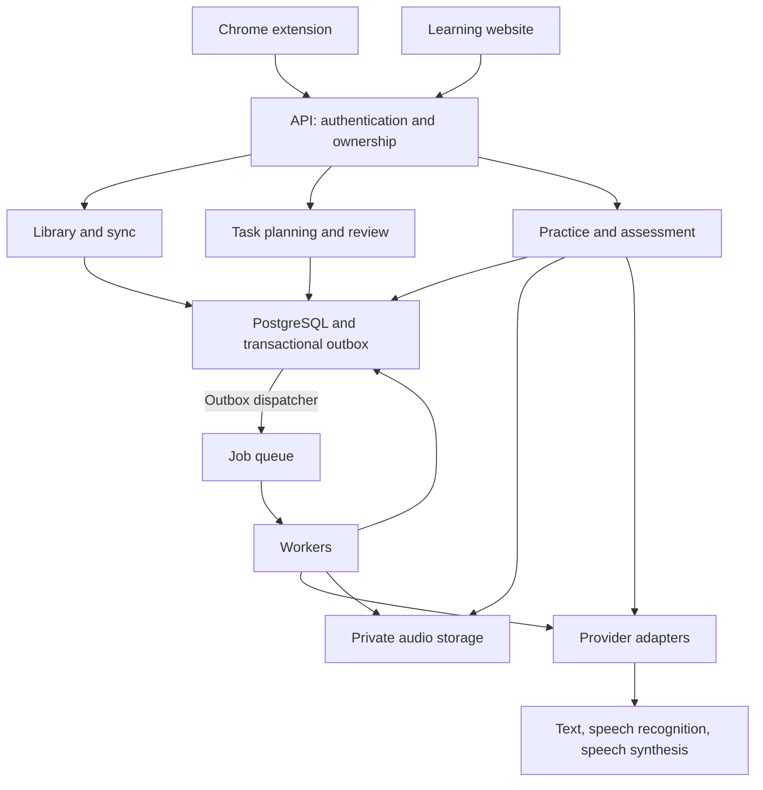

# Architecture design

## Technology

Proposed TypeScript stack: WXT + React extension, Next.js website, NestJS modular backend, PostgreSQL, Redis/BullMQ workers, and private S3-compatible audio storage. Use direct model/speech SDKs behind provider adapters.

Start with SQL retrieval. Add semantic retrieval/RAG only when needed; no dedicated crawler, LangChain, Python service, or microservices split is required for MVP.

## Components

One backend deployment with clear modules and separately runnable workers. Longer generation, assessment, and cleanup jobs expose status and recoverable errors.

## Core flows

**Capture:** user saves selected text → durable local outbox → authenticated API → database commit → acknowledgement. Scope event IDs by user for deduplication; retries return the same result. Keep state durable because extension service workers can stop.

**Practice:** planner selects relevant items → validated exercise → listening and recorded response → authorized audio upload → speech recognition and assessment → eligible skill update → next review. Typed alternatives do not count as spoken evidence.

## Data model

| Group | Records |
| --- | --- |
| Learner | User, goals, consent/preferences |
| Library | Learning item (specific sense/expression), source encounter |
| Practice | Versioned exercise, attempt, hint/replay use, retry relationship |
| Evidence | Assessment, rubric/model version, confidence, eligibility |
| Progress | Separate skill states, review schedule |
| Operations | Audio asset, outbox event, job status, usage/cost event |

Store attempts as evidence and skill states as rebuildable projections. Preserve ownership on every relationship; apply an assessment update once. Model context is not the persistent memory store.

## Reliability and privacy

- Save domain changes and outbox events in one transaction. Use idempotent workers, bounded retries, timeouts, and provider budgets; repeated external calls can still incur charges.
- Collect only selected text and bounded context; exclude forms and credentials, sanitize source URLs, and support pause/site exclusions.
- Derive ownership from the authenticated session; enforce it in APIs, jobs, and storage. Protect cookie-authenticated changes from CSRF.
- Keep secrets server-side, audio private, access URLs short-lived, and raw learner content out of general logs.
- Treat webpage excerpts as untrusted data. Validate model output and use reviewed fallback tasks when generation fails.
- Deletion revokes access, tombstones the account, cancels jobs, and removes active data/audio. Late jobs and restored backups must honor deletion; retention periods are set before pilot.

## Delivery structure

Proposed workspace: `apps/{extension,web,api,worker}` and `packages/{contracts,learning-core,ai-adapters,ui}`. Pin versions when scaffolding.

Separate development, staging, and production. Verify sync retries, ownership, assessment eligibility, audio failure, deletion, and capture-to-practice behavior. Monitor latency, queue age, errors, and session cost; rehearse backup restore and rollback before pilot. Scale from measured load.

## References

- [WXT](https://wxt.dev/)
- [Chrome content scripts](https://developer.chrome.com/docs/extensions/develop/concepts/content-scripts)
- [Chrome service workers](https://developer.chrome.com/docs/extensions/develop/concepts/service-workers)
