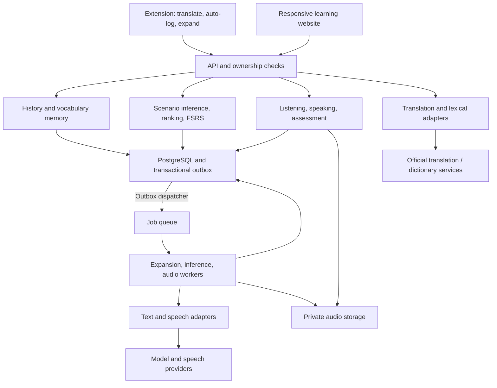

# Architecture design

## Stack and service choices

TypeScript throughout: WXT + React extension, Next.js website, NestJS modular backend, PostgreSQL, Redis/BullMQ workers, and private S3-compatible audio storage. Start with SQL retrieval and direct SDKs; RAG, LangChain, separate Python services, and microservices are deferred.

| Capability | Initial proposal |
| --- | --- |
| Selection translation | DeepL official API behind `TranslationProvider`; compare Microsoft Translator during M0. Use a deterministic fixture adapter for local development. |
| Definitions and spelling candidates | `LexicalProvider` with a separately approved dictionary; no bundled dictionary until license review. Development uses original fixture entries. |
| Meaning/examples and scenario inference | Structured-output text adapter, asynchronous expansion/inference, validation and reviewed fallback. |
| Word frequency | Versioned `FrequencyProvider`; source/license decision required before pilot; missing data is explicit. |
| Recall scheduling | ts-fsrs behind a pure review adapter; pin version and preserve license notices when installing. |
| Listening and conversation | Separate speech-recognition/text/synthesis adapters; providers chosen after quality/cost trials. |

Use only authorized official service credentials. Cache lexical/translation results only as permitted, keyed by language, sense/context, and provider version; keep private context scoped to its owner. Do not silently send content to an alternate provider on failure.

## Components

One modular backend plus workers. The website supports PC/mobile browsers; mobile-wide selection capture is not provided by the desktop extension. PWA/native capabilities are separate roadmap work.

## Core flows

**Lookup:** detect explicit selection-translation request → check collection settings/site eligibility → persist eligible event in durable local outbox → translate via backend → acknowledge committed history/candidate. Capture intent does not depend on translation success. Collection-off requests can translate without persisting learner content. Expansion has independent loading/failure states.

**Shared translation result:** collected queries use the lookup's persisted translation status/meaning for both the selection panel and library. `GET /v1/lookups/:id/translation` is owner-scoped and does not invoke the provider. Collection-off/excluded queries retain a transient translation-only path. The extension's local-storage lock never spans HTTP; a single-flight sync reconciles each acknowledgement against current records, preserving concurrent captures and cancellation.

**Sync:** scope client event ID by authenticated owner; commit encounter, candidate upsert, and job outbox atomically. Same event replay has no additional side effects; a later genuine lookup of the same expression is a new encounter. Preserve unresolved meanings. Local state survives extension-worker suspension.

**Personalization:** eligible history batch → scenario suggestions with source IDs/confidence → learner confirmation → versioned priorities and daily tasks. Activation is separate from collection; review submission updates FSRS once. Assessment-based reading/listening/speaking updates use separate evidence rules.

**Voice:** validated task → user-initiated recording → bounded private upload → recognition/assessment → feedback and eligible skill update. Typed fallback preserves progress but is not spoken evidence.

## Data model

| Group | Records |
| --- | --- |
| Learner | User, goal, collection consent/preferences |
| Memory | LookupEvent, LearningItem (candidate/active/archived), Encounter link, LexicalSuggestion |
| Personalization | ScenarioSuggestion with evidence IDs, accepted goal link, versioned PriorityScore/frequency provenance |
| Practice | Exercise, Attempt, hints/replays, retry relationship, explicit RecallRating |
| Evidence and progress | Assessment/version/confidence/eligibility, SkillState, FSRS ReviewSchedule |
| Operations | AudioAsset, transactional OutboxEvent, Job, content-free UsageEvent |

Attempts are evidence; skill states are rebuildable projections. Require ownership across linked records and idempotent updates. Define API contracts for the first flow in the [coding plan](superpowers/plans/2026-11-07-capture-to-library.md).

## Operational rules

- Bound excerpt length, recording size/duration, retries, provider concurrency, and per-user spending. Monitor errors, p50/p95 latency, queue age, and session cost.
- Exclude forms/credentials/restricted pages, strip URL query strings/fragments, and honor consent/site changes before sending queued content. Never collect full history or record in the background.
- Authenticate server-side; enforce owner scoping in API, worker, and storage. Protect cookie-based changes from CSRF. Secrets stay server-side; logs exclude raw excerpts, recordings, tokens, and signed URLs.
- Treat excerpts as untrusted data; validate model outputs and provide reviewed fallbacks. A model cannot assign itself tool permissions.
- Use transactional outbox, idempotent workers, timeouts, bounded retry, and visible failures. Duplicate external calls may still cost money.
- Account deletion revokes access, tombstones the user, cancels work, and removes active data/audio. Late jobs and restored backups honor tombstones; agree retention before pilot.
- Separate dev/staging/production. Verify ownership, retry/consent races, evidence eligibility, deletion, restore, and the full journey before release.

Proposed workspace: `apps/{extension,web,api,worker}`, `packages/{contracts,learning-core,ai-adapters,ui}`. Scaffold only the pieces needed for the first slice, with pinned compatible versions.

## Implemented authentication

Google OIDC login uses authorization code + PKCE through openid-client. Website sessions use hashed server records and HttpOnly cookies; extension pairing issues separate revocable credentials after explicit approval. Cookie writes require Origin + CSRF verification. A per-account extension version makes revocation effective across concurrent exchanges. See [login setup and boundaries](LOGIN.md); Google credentials and live-provider verification are still required.

## References

- [WXT](https://wxt.dev/), [Chrome service workers](https://developer.chrome.com/docs/extensions/develop/concepts/service-workers)
- [DeepL API](https://developers.deepl.com/docs/getting-started/quickstart), [Microsoft translation](https://learn.microsoft.com/en-us/azure/ai-services/translator/text-translation/overview)
- [NestJS authentication](https://docs.nestjs.com/security/authentication)

## Implemented local translation

A loopback LibreTranslate service now provides free word/sentence translation. Python dependencies and English/Chinese model checksums are pinned. The API validates installed languages and sends only selected text; language preferences are owned by each account and snapshotted per lookup. The extension supports manual or opt-in automatic selection translation and shares one persisted result with the library. See [free translation setup](TRANSLATION.md).
