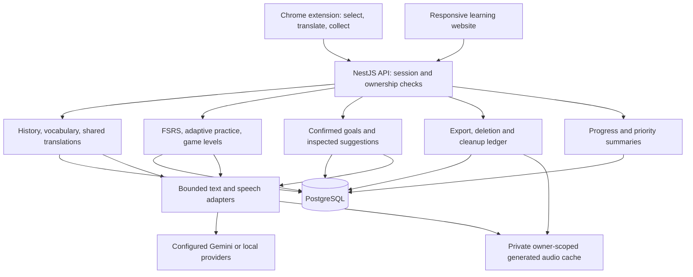

# Architecture design

## Current implementation

TypeScript throughout: WXT + React extension, Next.js website, one NestJS modular API and PostgreSQL. Local development uses a pinned embedded PostgreSQL binary and private generated-audio files. Bounded in-process work and persisted pending lookups support the current local MVP. Redis/BullMQ, shared object storage and independent workers are deployment options for measured scaling needs; they are not installed services in this implementation. No RAG or LangChain is required.

| Capability | Implemented approach |
| --- | --- |
| Translation and examples | Interchangeable Gemini, local Ollama and optional LibreTranslate adapters; deterministic fixtures only for tests. |
| Word expansion | Separate nonblocking Gemini enrichment for English words, preserving the original shared translation. |
| Scenario suggestions | Explicit learner-triggered structured Gemini analysis of owned saved excerpts; validated evidence IDs and confirmed goals. |
| Vocabulary priorities | Deterministic signals with a pinned, attributed CC BY-SA subtitle-frequency snapshot; unknown data stays explicit. |
| Review | FSRS recall queue, explicit enrollment, retry-safe ratings and pause/resume. |
| Listening and speaking | Cached AI audio, optional local Phonon English synthesis, structured speech assessment, independent evidence rules and adaptive practice. |
| Progress and account | Owned SQL dashboard, full JSON export, active-data deletion and durable local-audio cleanup retries. |

Use configured provider credentials only. Keep keys server-side and scope private translation/audio caches to the account, language, context and provider version. Local text mode makes no cloud scenario calls. An unavailable enrichment leaves the saved base translation intact; no silent provider substitution.

## Components

The website serves PC and mobile browsers. The desktop extension does not capture selections across mobile apps. School roles, native apps and real-player matchmaking remain separate projects.

## Data and request boundaries

- `User` owns vocabulary items, lookup events, sessions, device pairings, generated-audio indexes, game attempts/level runs and a versioned learning profile. Composite ownership relations prevent cross-account links. Review and practice records cascade through their owned vocabulary/lookup parents.
- Browser collection writes its durable local outbox before synchronization. Account/event IDs deduplicate delivery. The stored lookup's translation status is the durable pending-work marker; the library and selection card use that same result. Collection-off requests do not create lookup history.
- Gemini expansion is optional work after the initial translation. Scenario analysis requires ten distinct new saved English contexts and an explicit request. Snapshot hashes prevent duplicates and preserve eligibility for contexts captured during generation. Model output cannot directly enroll review cards or overwrite learner goals.
- Dashboard reads are bounded and make no model calls. Reliable speech requires the current rubric and clear audio; independent tasks are distinct from assisted/repeated attempts. Priority scores are not mastery estimates.
- Website sessions use HttpOnly cookies with CSRF checks. Pairing creates separate revocable device access. Trusted session identities pin the exact internal account UUID; late requests cannot recreate a deleted account through an issuer/subject upsert.
- Data export uses a consistent owned transaction, keyset pages and a private unlinked staging descriptor, then streams JSON. Account deletion locks the user, writes a standalone `AccountDeletion` tombstone, cascades active records, revokes sessions and purges owner caches. Audio cleanup failures remain pending and retry; late work cannot repopulate a deleted owner's cache. Fresh login intentionally creates a new UUID.

## Release and scaling boundaries

`pnpm dev` is deliberately local-only and refuses production mode. API production guards require real OIDC, explicit public HTTPS origins and non-simulated providers. Sanitized public liveness/readiness checks and authenticated aggregate counters are wired; provider health, operator alerts and durable usage accounting require deployment work.

Before restoring traffic, replay the latest independently retained deletion ledger against restored records, reset media cleanup markers and verify private audio erasure. The synthetic recovery tool proves only its invented-data logical roundtrip, not production pg_dump/PITR or multi-replica media recovery.

Select hosting, geography, retention, shared storage/worker topology, connection limits, rate limits and cost budgets from measured pilot load. Five million registered users is a planning target, not a capacity claim. Real Chrome/device trials, human speech-mark calibration, held-out learning outcomes and production recovery/alert rehearsals remain external gates. See [pilot checks](PILOT.md), [account controls](ACCOUNT.md), [personalization](PERSONALIZATION.md) and the [MVP checklist](MVP_CHECKLIST.md).
