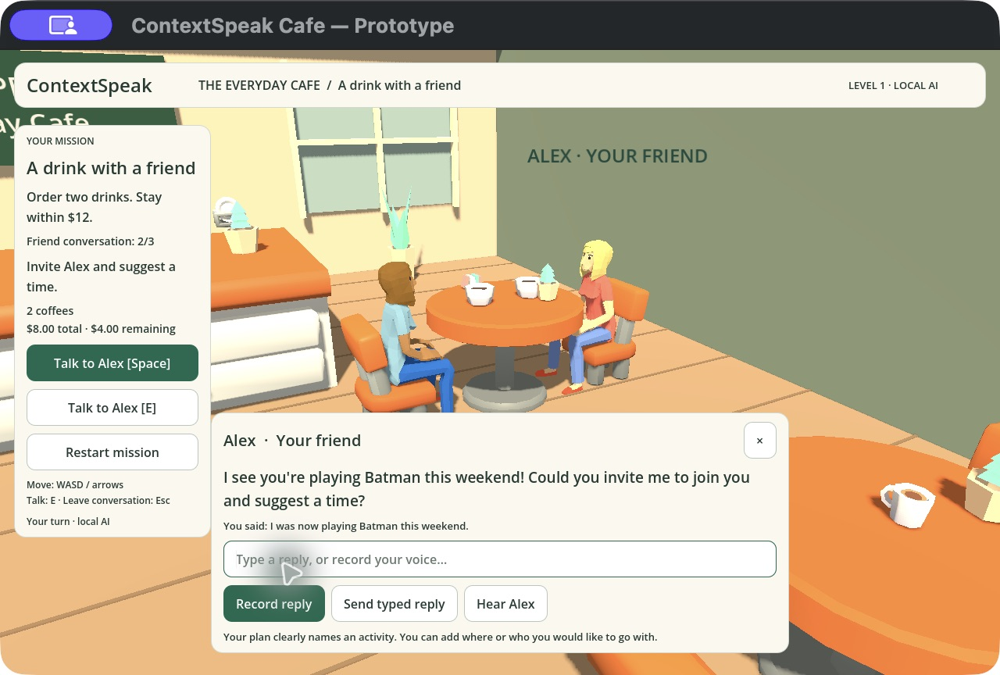
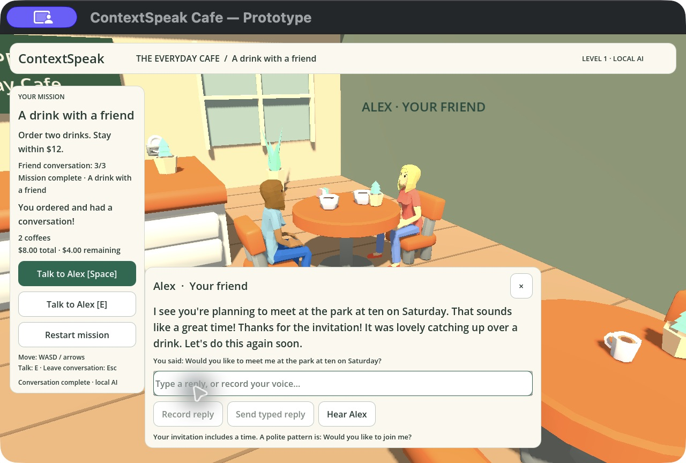

# Free café art and dialogue repair — 10 November 2026

This records the earlier imported-art milestone. The current campus appearance and
manual stage selection are covered in [Campus café playtest](CAMPUS_CAFE_PLAYTEST.md).

## Delivered

- Three Quaternius character instances with distinct original clothing atlases,
  mapped idle/walk/seated actions and real skeleton-based human scale.
- KayKit Restaurant Bits 1.0 FREE tables/chairs, counter modules, kitchen equipment,
  jars and entry door. Existing Kenney coffee/food/plants remain. A closer table
  camera keeps both people above the dialogue panel; cups have ordinary proportions.
- Original voiced counter ordering, local recording, automatic walk/seating,
  friend questions, typed fallback and local guest saves remain in place.
- The exact screenshot answer, “I was now playing Batman this weekend.”, advances
  to the invitation stage despite imperfect grammar. The old activity regex missed
  inflections such as playing; the small model could reject the tense, after which
  the game blindly read the original question again. Missing answers now get a
  goal-specific repair hint instead. Meaning and language correction stay separate.

## Verification evidence

- Godot mission/UI/friend/placement/avatar checks pass. Avatar checks cover actual
  Idle/Walking/SitIdle playback, human scale, lower seated hips, clothing and standing
  again. Placement checks include the new KayKit table/chair.
- Offline verification checks 41 pinned source/license files. A Python regression
  covers creator SHA-256, legacy Git blob hashes and rejection after tampering.
- Four exported browser regressions cover ordering/budget, saved journey completion,
  rejected-answer repair, browser recording submission and failed-recognizer fallback.
- A real local-model WebGL test used five public synthetic microphone recordings
  through Whisper, Phonon NPC playback and Qwen friend replies, then typed the exact
  Batman sentence and an invitation. It completed and restored the 3/3 conversation.
  This is synthetic microphone evidence, not human speech-recognition accuracy.
- The exported macOS app was opened and inspected. Native UI walkthrough verified
  movement, barista voice status, recording start/stop, no-speech recovery, typed
  ordering, automatic walk/seating, preference feedback, Batman answer advancement,
  invitation and visible 3/3 mission completion. No person supplied spoken test audio.
- Web and macOS ZIP exports build; macOS headless startup has no script errors.
  TypeScript and formatting pass; the final combined regression suite has
  294 passing tests in 64 files.

## Limits

Desktop means macOS in this verification; Windows is still an untested preset.
All three actors share one seated-capable rig with different clothing. These are
free low-poly characters, not photorealistic people or lip-synced facial animation.
The guided conversation still has three authored goals; novel expressions may
remain model-dependent. The game does not claim human pronunciation accuracy.
Local tools/models/companion are still required for the unsigned desktop prototype.

## Native evidence

