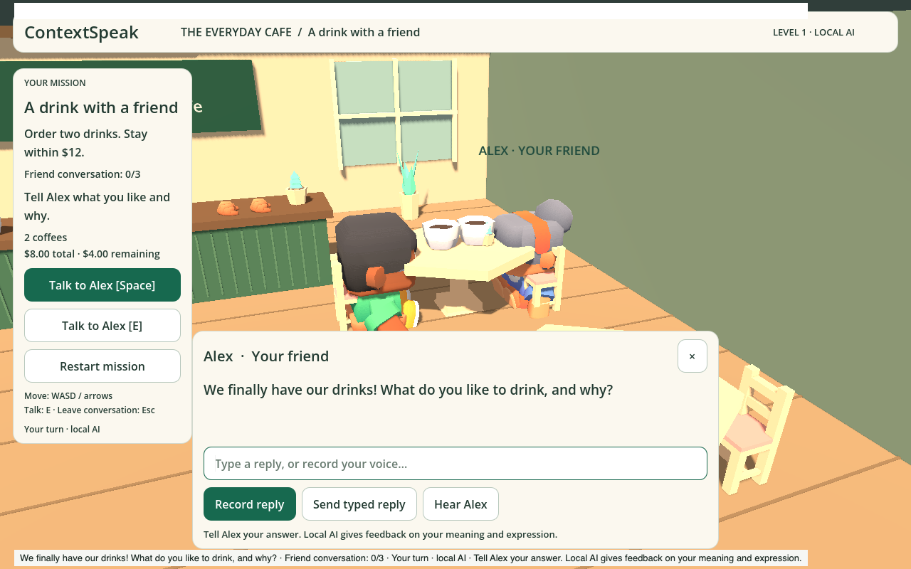
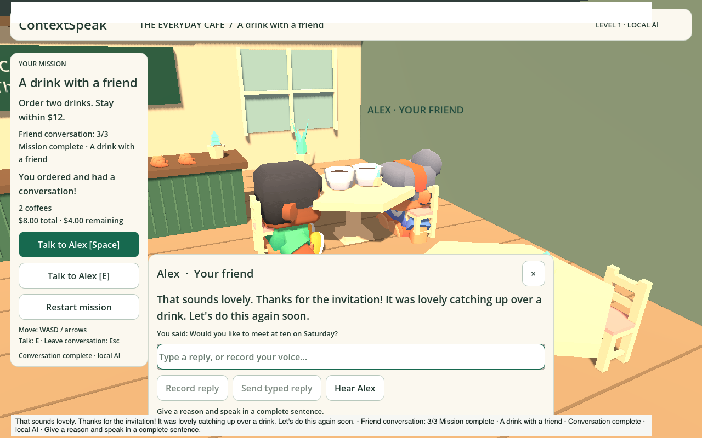

# Café counter-to-table playtest — 10 November 2026

## Journey implemented

Walk to Maya, hear the ordering questions, choose two drinks within $12 and
confirm. When the final voice line ends, carry the drinks to Alex, sit down and
hear the first friend question automatically. A manual Join Alex action remains
available after a voice failure. Alex acknowledges each reply and asks the next
of three guided questions: a preference with a reason, a weekend plan, and an
invitation with a proposed time. Record/stop checks the reply automatically;
typing is also available. Progress survives refresh in a versioned local save.

Web voice now owns actual AudioContext decode/start/end/cancel rather than
assuming a generated WAV means playback. The initial Talk gesture unlocks it.
Closing/resetting cancels pending recordings, models and voices. Native playback
continues through Godot. Local AI remains Qwen + Whisper + Phonon; no cloud call.

## Problems found and repaired

- A clear weekend plan was rejected by Qwen. Clear task evidence now corrects
  inconsistent verdicts, while other phrasing remains model-reviewed. Help
  requests and prompt instructions cannot pass by quoting an example answer.
- Valid reasons and time expressions outside the small keyword lists, such as
  “for its rich aroma” and lunchtime,
  remain eligible for model review. No accent or pronunciation claims are made
  from transcription text alone.
- Alex's tips were overwritten by order feedback when playback ended. Tips now
  persist through status refreshes and the latest accepted tip restores on load.
- Imported table/chair/character origins were off center. Normalization now
  centers X/Z and places the base on the floor; geometry regression checks cover
  all three models. The seated camera frames the two people above the reply panel.
- Old counter text no longer appears as a reply to Alex on arrival.

## Verification

- Full TypeScript regression suite: 285 tests in 64 files passed.
- TypeScript and repository Prettier checks passed; production website built.
- Godot mission, dialogue UI, friend-state and asset-placement checks passed.
- Exported WebGL journey: four browser regressions cover ordering/budget,
  synthetic microphone submission, service failure with typed fallback, friend
  rejection/retry, voice lifecycle, completion, retained feedback and reload.
- Local-model browser integration: five public synthetic microphone recordings
  exercised actual Whisper transcription, ordering and one friend answer; two
  later typed answers completed the conversation through actual Qwen. Phonon
  generated/played NPC replies; completion survived refresh. This was a fake
  Chromium microphone, not a person's microphone or subjective listening test.
- Web and unsigned macOS exports built. Native headless startup checked; native
  physical microphone/device playback still needs a human test.

## Scope and remaining checks

This is a guest prototype on this computer, not account-synced learning evidence.
Three guided questions do not yet form open-ended conversation, human pronunciation
assessment or ten difficulty levels. Local model responses can still be slow or
misjudge unfamiliar phrasing. A small human pilot should verify intelligibility,
real microphone noise/accent handling and whether hints help learners recover.

New free art candidates are documented in [FREE_3D_ASSETS.md](FREE_3D_ASSETS.md).
No untested candidate pack has replaced the current credited CC0 Kenney assets.

## Screenshots

