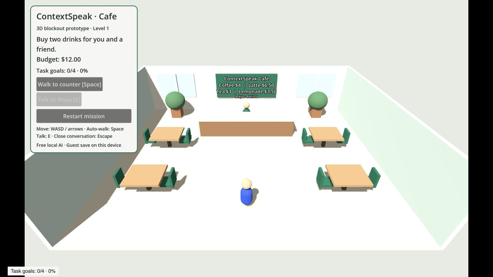
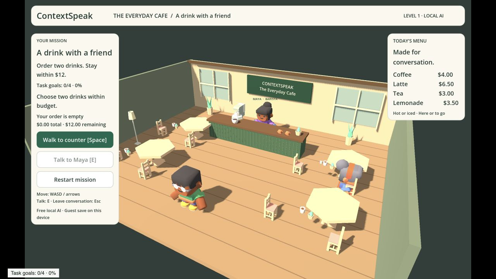
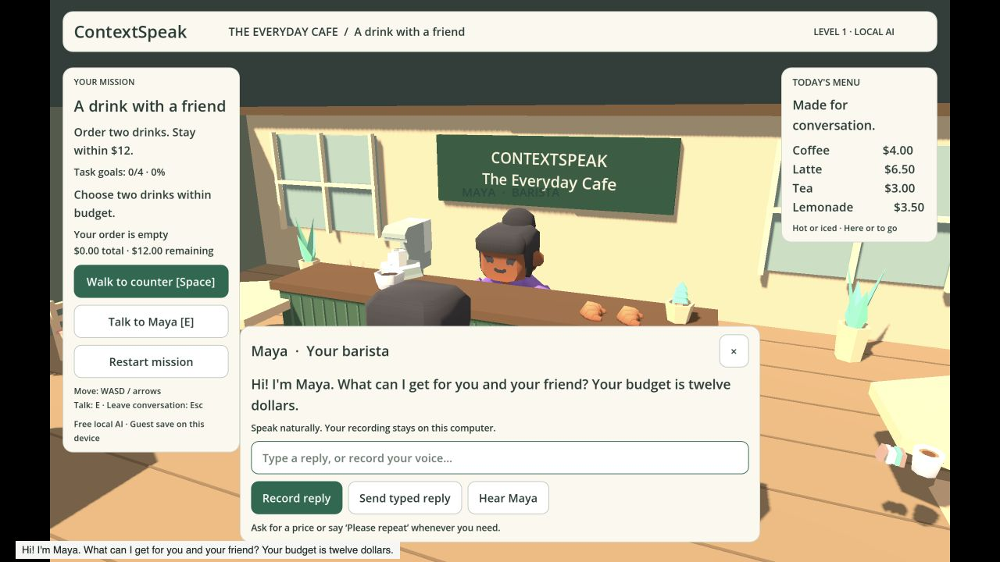
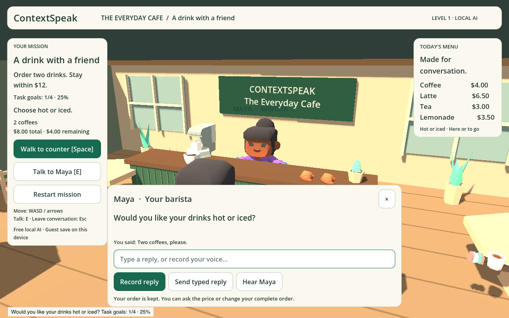
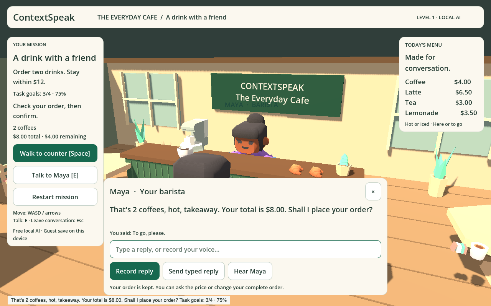
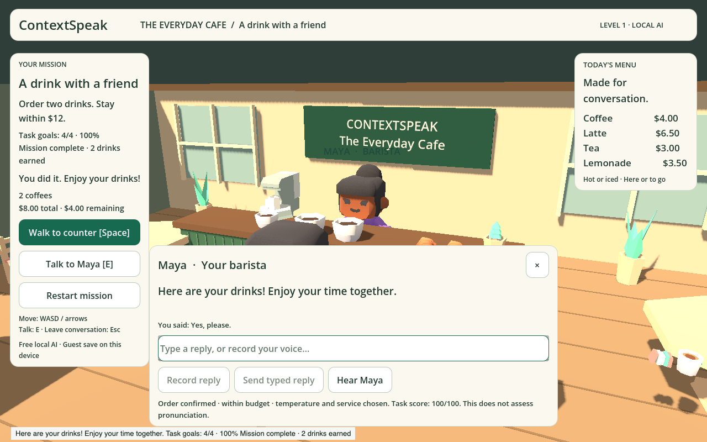

# Café user-flow playtest — 10 November 2026

This records the initial order-only milestone. For the current voiced
counter-to-table journey, see [Café friend playtest](CAFE_FRIEND_PLAYTEST.md).

The café was tested from its rendered browser UI, with fresh screenshots and a
separate real local speech integration test. The website redesign was preserved.
The game remains a single-mission development prototype.

| Step | Result | What was checked and improved |
| --- | --- | --- |
| 1. Arrive and find Maya | Pass | Movement, counter approach and interaction; readable mission/menu, furnished café and animated characters. |
| 2. Record a reply | Pass with synthetic input | Four public synthetic WAV recordings passed through the browser microphone pipeline and real local Whisper. Stopping checks the reply automatically. |
| 3. Answer follow-ups | Pass | Actual recognized order, temperature and takeaway replies advance the NPC. Price, budget correction and edited options retain the order. |
| 4. Confirm | Pass | “Is that correct?” and reported/negative agreement do not complete a task. A final explicit spoken “Yes, please” does. |
| 5. Complete and return | Pass | Two drinks appear, task score is shown, reply controls stay disabled and immediate reload restores completion. |
| 6. Recover from a failed check | Pass | A simulated unavailable recognizer keeps the task and restores keyboard focus for a typed reply. Silence is rejected before recognition. |

## Issues found and fixed

- **Misleading success:** “Is that correct?” originally completed the mission.
  The deterministic final-confirmation gate now requires an affirmative reply;
  a model cannot upgrade an ambiguous final answer into agreement.
- **Missing audio:** roughly four seconds of input yielded about 1.6 seconds of
  PCM through the no-thread Godot Web audio pipeline. The browser now uses an
  AudioWorklet independent of the renderer. The diagnostic run captured 4.08
  seconds and correctly recognized the public sample. Native capture reserves
  its buffer once rather than growing it for every sample.
- **Recovery focus:** after a failed recognition check, typing did not reliably
  reach the reply field. Successful and failed checks now restore that focus.
- **Confusing edits:** temperature/service could not be changed at confirmation;
  some rejected choices were selected. Options can be corrected, while rejected
  or unclear choices retain the previous state.
- **Late microphone setup:** stopping while permission/setup was pending could
  allow a later recording. Cancellation now stops late tracks and cannot submit.
- **Sample-rate mismatch:** the browser explicitly requests 48 kHz so a 96 kHz
  default device does not produce WAV rejected by the companion.
- **Layout:** deferred text reflow could inflate panels or restore obsolete
  widths. Height fitting now preserves the latest assigned width. Completed
  tasks cannot re-enable reply controls after pending work finishes.

## Visual changes

Warm wood and green café fixtures, genuine CC0 furniture/food models, three
animated characters, coffee equipment, windows and a reading/seating area replace
the primitive blockout. Conversation brings the camera closer; the browser's
reduced-motion preference disables the camera transition. Clear order totals,
remaining budget, current goal, microphone meter and timer support the task.
There is no background music competing with speech.

See [art sources and licenses](../games/cafe/assets/CREDITS.md). All 16 vendored
model/texture files have pinned source URLs and checked hashes.

## Validation

- Full unit/API suite: **276 tests across 62 files passed**.
- Exported-WebGL regressions: **3 passed**, covering task/save/restore, recording
  submission and recognition failure/typed recovery.
- Optional real local speech regression: **1 passed**, covering **four recorded
  replies**, actual Whisper recognition and NPC WAV generation, follow-ups,
  ambiguous confirmation and saved completion. It uses a synthetic microphone,
  with no mocked transcript and no cloud AI.
- Godot mission, silence, dialogue layout and completion-control checks passed.
- TypeScript, formatting, asset verification and Web/macOS exports passed.
- macOS startup was smoke-tested headlessly; physical microphone operation in
  the desktop client was not tested.

Reproduce with `pnpm world:test`, `pnpm test`,
`pnpm exec playwright test --config playwright.world.config.ts world.spec.ts`,
and `pnpm world:test:voice`. See [setup](../games/cafe/README.md).

## Evidence and limits

Screenshots were captured before and after the changes. The final screenshot
set shows arrival, recognized order, follow-ups and completion. Synthetic input
verifies the actual recording/recognition path but does **not** establish physical
microphone quality, human accent accuracy, or pronunciation scoring. The score
measures communication-task goals, not language proficiency. The Canvas/live
status and keyboard flow were checked; full screen-reader usability and mobile
layout still need separate testing. Windows remains unverified.

Before a small pilot, try the mission with several real learners and different
microphones. Measure clipped starts, recognition corrections, voice latency and
whether learners understand why an order is accepted or rejected.

## Captured flow

1. Arrival before improvements (layout and primitive character comparison).
   
2. Arrival after improvements: mission, readable menu and furnished scene.
   
3. Open conversation: closer camera, readable Maya and a typed/recorded choice.
   
4. First local recording recognized, followed by Maya's temperature question.
   
5. Temperature response recognized; Maya asks about service.
   
6. Service response recognized; final order is summarized before agreement.
   
7. Explicit final spoken agreement: reward, receipt and task feedback.
   
