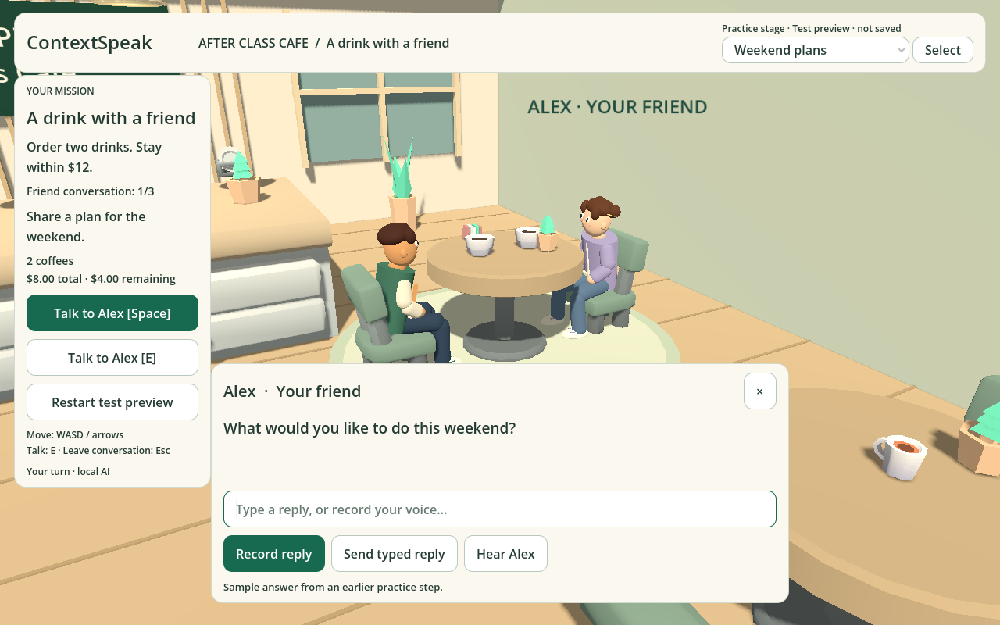

# Campus café and selectable practice stages — 10 November 2026

## Appearance

User-selected direction: cute campus characters intended to read as mid-teens,
with cream, light wood and sage café interiors. Original cartoon faces/hair,
varsity jackets/hoodies, trousers, backpacks and sneakers now follow the licensed
Quaternius animated skeleton. Original source mesh is hidden; no paid Teen mesh
is used. The inspected free base-character Standard ZIP did not contain Teen
entries. Approximate age is an art direction, not a verified model age.

KayKit source bytes retain their hashes. A small palette shader changes orange
furniture regions while preserving the shared atlas details. Original pendant
lights, slatted wood, welcome signage, a bench and a rug establish the counter,
entry and friend-table areas. Face/clothing pieces skip unnecessary shadow draws.

## Testing controls

The top-right Practice stage picker has six options and an explicit Select action:
saved journey, counter, preferences, weekend plans, invitations and completion.
Direct stages are fixture previews; they cannot write the normal save. Restart
resets the chosen preview, Resume/reload restores the original guest journey.
Pending recording/audio/AI work is cancelled before switching. Session reconnect
uses the selection epoch, so an early switch cannot lose the companion connection
or replay a stale question. NPC speech follows an explicit Select.

## Verified

- Eight Godot checks pass: mission, interface, friend, placement, campus avatar,
  preview fixtures, runtime switching/save isolation and session/speech races.
- Six browser regressions pass: both preview/resume/stale-response cases, full
  voiced order-to-friend completion/reload, budget correction, recording submission
  and recognizer failure with typed recovery. Shader/script errors are checked.
- After hiding the duplicate visual live-caption footer (keeping a standard
  screen-reader live region), both stage browser regressions pass again with
  valid WAV playback, including automatic speech after explicit Select. The
  screen-reader status remains exposed to accessibility and automated checks.
- Real local-model WebGL integration passes: five public synthetic microphone
  recordings through local Whisper, Phonon NPC playback, Qwen friend feedback and
  the exact previously reported Batman answer; final 3/3 completion restores.
- Full Vitest suite: 294 tests in 64 files; TypeScript and Prettier pass.
- Web/macOS exports build; native headless startup passes. Native preview tests
  verify the existing real save is unchanged. This update's browser audio test is
  synthetic; no human microphone accuracy claim is made.

## Rendering/test boundaries

The Godot dummy headless renderer cannot safely handle repeated material-override
shader queries, so cosmetic recolouring is skipped there. Geometry/rig checks
remain active; real palette rendering is verified in the exported WebGL game.
The actual mesh/texture source bytes still pass offline provenance verification.
The desktop build still needs the local companion/Ollama, and Windows is untested.

These choices are test checkpoints within the existing café mission. They do not
pretend that six newly authored campaigns or ten difficulty levels exist. Preview
sample answers are clearly labelled and do not become earned learning evidence.

## Rendered preview

