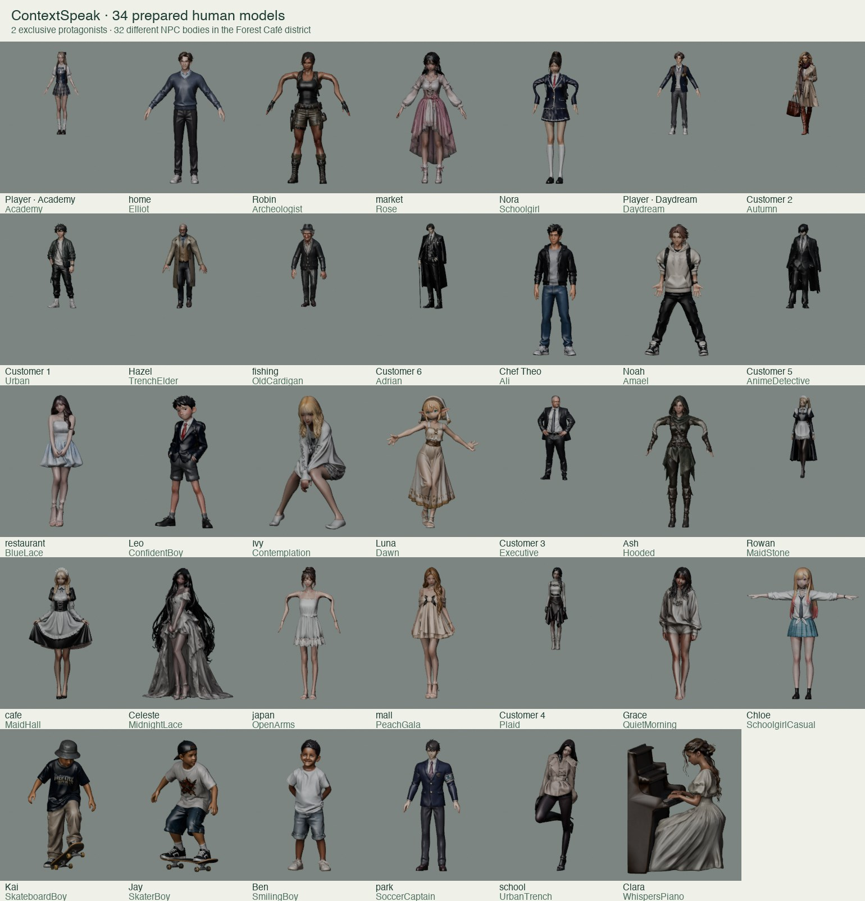

# Downloads FBX import and town cast

The 2026-11-13 scan found 191 FBX source entries (187 archives and four loose files),
representing **189 unique FBXs** after SHA-256 deduplication. All 189 native FBXs
and their importable textures are in `games/unity/Assets/_Game/Art/MeshyLibrary`;
Unity's import report contains zero errors. Repeat imports keep stable asset paths.
Furniture, buildings, plants, animals and alternate animation exports remain in
that searchable library; they are not incorrectly classified as extra people.

Visual inspection identified **34 distinct human identities**. Academy and Daydream
are exclusive selectable protagonists. The Forest Café district uses the other
**32** identities exactly once each. Separate worlds reuse the same named person
where appropriate, without duplicating a body within one scene. This is an actor
assignment update; existing mission IDs, wallet and main quest progress remain.

Use Unity's **ContextSpeak → Meshy → Open FBX library** for native sources and
**Open character preview** for the optimized roster. The main scene is
`Assets/Generated/ForestSlice.unity`; press F near a resident to talk. New residents
use the established topic-based lessons and correction gate, with independent
save keys such as `park:SkateboardBoy`. The same question does not count as another
resident's completed conversation. Additional authored dialogue/personality sets
can be added later; this change does not claim 32 unique lesson scripts.

## Prepared character preview

This local Blender inspection sheet shows the prepared game geometry and textures;
it is not a gameplay screenshot. Source poses and model scales differ intentionally.

## Forest Café district assignments

| Actor | Model | Function |
| --- | --- | --- |
| Rowan | MaidStone | Existing mission / ambient actor |
| Hazel | TrenchElder | Existing mission / ambient actor |
| Chef Theo | Ali | Existing mission / ambient actor |
| school | UrbanTrench | Existing mission / ambient actor |
| home | Elliot | Existing mission / ambient actor |
| market | Rose | Existing mission / ambient actor |
| restaurant | BlueLace | Existing mission / ambient actor |
| japan | OpenArms | Existing mission / ambient actor |
| park | SoccerCaptain | Existing mission / ambient actor |
| mall | PeachGala | Existing mission / ambient actor |
| cafe | MaidHall | Existing mission / ambient actor |
| fishing | OldCardigan | Existing mission / ambient actor |
| Customer 1 | Urban | Existing mission / ambient actor |
| Customer 2 | Autumn | Existing mission / ambient actor |
| Customer 3 | Executive | Existing mission / ambient actor |
| Customer 4 | Plaid | Existing mission / ambient actor |
| Customer 5 | AnimeDetective | Existing mission / ambient actor |
| Customer 6 | Adrian | Existing mission / ambient actor |
| Robin | Archeologist | Outdoor guide |
| Nora | Schoolgirl | Student |
| Noah | Amael | Student |
| Leo | ConfidentBoy | Visiting student |
| Ivy | Contemplation | Neighbour taking a break |
| Luna | Dawn | Festival performer |
| Ash | Hooded | Festival guide |
| Celeste | MidnightLace | Restaurant guest |
| Grace | QuietMorning | Neighbour |
| Chloe | SchoolgirlCasual | Student |
| Kai | SkateboardBoy | Skateboarder |
| Jay | SkaterBoy | Skater |
| Ben | SmilingBoy | Park visitor |
| Clara | WhispersPiano | Restaurant pianist on a break |

## Source versus game copy

Original FBX geometry, textures and clips stay in the local source library.
The game uses bounded GLBs, not the multi-GB source meshes. New copies target
30k triangles and 1024px textures. Static people keep their authored poses; selected
moving actors get basic weighted head/leg rigs. Two older walking rigs are baked
into their supplied pose before receiving a basic rig to avoid incompatible
centimetre bind transforms. Their source animations remain inspectable in FBX.
No cloud conversion or source deletion occurs.

Reproduction commands and import limitations are in [the Unity README](../games/unity/README.md).
The multi-GB source library is Git-ignored and rebuilt from local Downloads;
asset redistribution rights are not inferred from possession of a downloaded ZIP.

## Verification

- Native library: 189 FBXs, zero import errors; textured embedded-image characters
  checked on both the FBX and wrapper prefab.
- Prepared assets: 18 Python pipeline/library/cast tests passed.
- Unity: geometry/rig budgets, unique actor bodies, all resident arrival paths,
  player profile, native UI and counter interaction checks passed.
- Browser: all 26 packaged Unity tests passed, including recording capture,
  fixture transcription/feedback, independent Kai/Jay conversation progress and
  reload recovery. These fixtures test integration, not live ASR accuracy.
- Project: 609 regression tests and TypeScript checks passed.
- Updated Web and macOS builds succeeded; final Editor import/geometry check passed.
