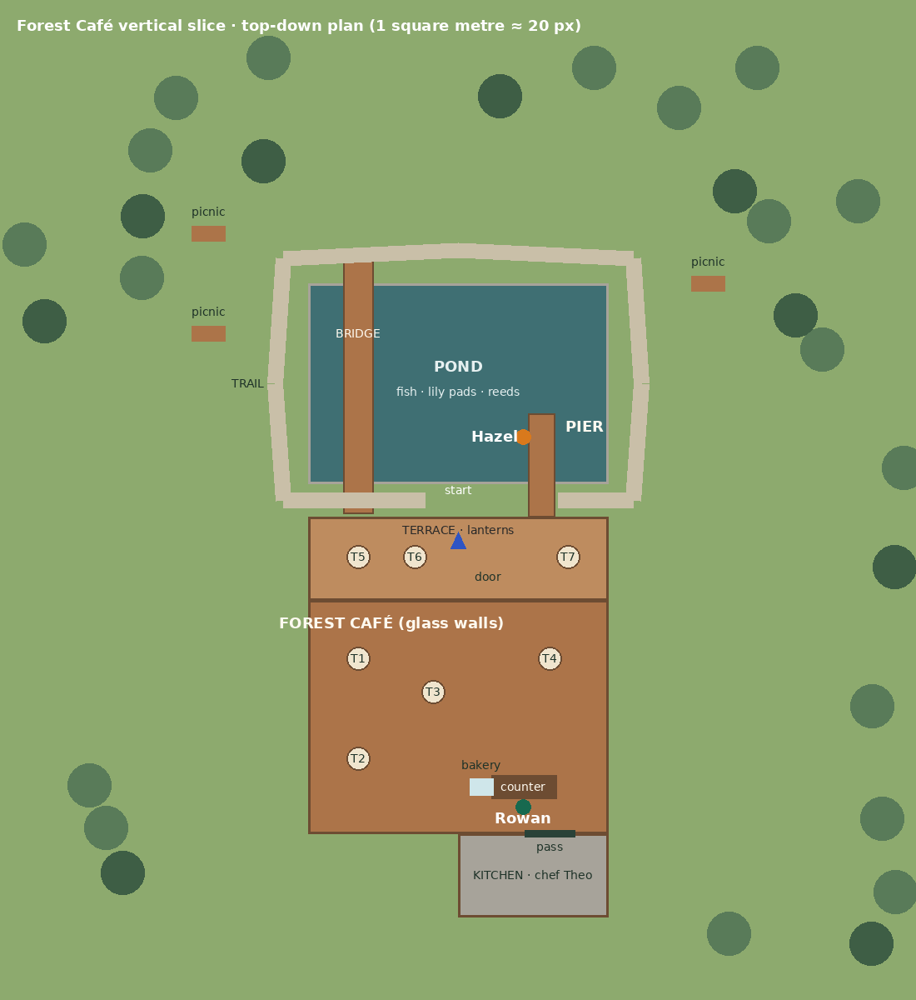

# Living World · Milestone 1: Forest Café vertical slice

This milestone covers phases 1–4 of the Living World brief. Its goal is one playable,
slice and visual benchmark: better movement, a forest café with a working waiter, a menu, ordering, payment,
seating, eating and drinking, fishing with an instructor, and spoken English conversations
that adapt to the learner's level.

**Difficulty follows IELTS Speaking bands, not CEFR.** Feedback is grouped by the four public
IELTS Speaking criteria.

These are practice difficulty labels and heuristic learning notes, not official IELTS scores or
a validated assessment. A dedicated pronunciation provider is not configured in this slice.



## How to play

1. Run `pnpm unity:prepare` to import the verified art, then `pnpm unity:build:web` to
   generate the scenes (including `Assets/Generated/ForestSlice.unity`) and build the browser preview.
   In the Editor you can also use
   **ContextSpeak → Rebuild Forest Café slice only**.
2. Optional, for voice: run `pnpm world:dev`. This starts the local companion, which provides
   speech-to-text, text-to-speech and the local Qwen reviewer.
   - Without it the game still works: you type your replies and NPC lines appear as subtitles.
3. Open `ForestSlice.unity` and press Play.
   - Desktop builds open the slice by default.
   - The web build opens it with `?world=slice`.
   - From the Life town, use the **Forest Café (new)** button.

### Controls

| Input                             | Action                                                                  |
| --------------------------------- | ----------------------------------------------------------------------- |
| WASD / arrows / left stick        | Move. Default jog is 7 m/s.                                             |
| Ctrl (hold) or Caps Lock (toggle) | Walk at 4.5 m/s                                                         |
| Shift                             | Sprint at 9 m/s                                                         |
| Space                             | Jump. Coyote time and jump buffering are included.                      |
| C                                 | Crouch. You only stand up when there is head room.                      |
| Mouse                             | Rotate the camera while exploring. Right-drag also works.               |
| Scroll                            | Zoom the camera                                                         |
| F                                 | Talk to the nearest NPC                                                 |
| E                                 | Sit or stand, eat or drink, read the menu board, fish (cast and strike) |
| Left mouse                        | Hold to reel in. Also strikes on a bite.                                |
| Tab                               | Bag: wallet, fish, catch log and receipts                               |
| M                                 | Map                                                                     |
| J                                 | Journal: quests and the learning dashboard                              |
| Esc                               | Close the current panel or conversation, otherwise open settings        |

Typing in a text field never moves the avatar, and open panels suspend movement. All speeds,
acceleration, jump, gravity, slope, crouch, camera and mouse-sensitivity values are editable on
`CafePlayer` in the Inspector.

## Difficulty: IELTS-inspired targets 3–9

New games start at **3**. Existing saved levels, orders, receipts and progress remain unchanged.
Choose any target in **Esc → Settings**; use **M → Map** to visit a place or retry its conversation.
The map also plans a saved three-stop speaking trail from your target, everyday/dining/shopping/travel
need and optional focus vocabulary. Completion counts only lessons at the selected target.
The speaking lodge's **E** mission board opens the same planner. See the
[Blender art and rendering notes](../art/blender/README.md) for model sources, regeneration and visual limits.

| Target | Speaking focus                                          | Market example                                          |
| ------ | ------------------------------------------------------- | ------------------------------------------------------- |
| 3      | Short concrete answers, familiar objects                | What fruit would you like?                              |
| 4      | Link simple ideas and give one detail                   | What fruit would you like? Add one detail.              |
| 5      | Describe experience and preference                      | Would you pay a little more for locally grown produce?  |
| 6      | Reasons, comparisons and paraphrase                     | Explain your choice.                                    |
| 7      | Developed views, examples and conditional language      | How could the market reduce food waste?                 |
| 8      | Precise collocations and different perspectives         | Consider a different point of view.                     |
| 9      | Qualified claims, counterexamples and unfamiliar angles | Is seasonal produce always the more sustainable option? |

Original tasks are informed by the [public IELTS Speaking descriptors](https://ielts.org/cdn/ielts-guides/ielts-speaking-band-descriptors.pdf).
There is no claim of an official IELTS vocabulary list, predicted score or complete mock examination.
Usefulness, precision and appropriate communication matter more than rare vocabulary or forced idioms.

Each of eight places has three questions at every target: home, café, fishing pier, market,
Western restaurant, Japanese restaurant, amusement park and shopping gallery. Vocabulary hints
are optional. Beginner validation follows the current question (including natural short replies);
discussion targets 6–9 ask for developed reasoning, and 9 asks learners to qualify their claim.
With the local companion connected, resident recordings are checked by the installed local AI against the actual question and speaking goal; a correct paraphrase is accepted without requiring particular connector words. Failed or incomplete AI checks preserve progress for retry. Offline text-only relevance/development hints are conservative heuristics, not a semantic examiner. The model never controls money or inventory.

Voice speed ranges from slower beginner speech to natural discussion speed, with pitch-preserving
replay. There is no artificial expert-speed or accent penalty. A normal brief payment reply is valid
at every target. The game suggests a higher practice target after sustained success; this is not a
measurement of the learner's IELTS ability.

| Correction mode | Default target | Behaviour                                   |
| --------------- | -------------- | ------------------------------------------- |
| Practice        | 3–5            | Corrections are optional.                   |
| Guided          | 6–7            | Important errors are held for spoken retry. |
| Challenge       | 8–9            | Flagged errors are held for spoken retry.   |

After repeated difficulty, the model-answer escape remains available without awarding independent
spoken credit. A typed rehearsal never bypasses a required spoken correction. Accepted transactions
commit only once. Resident conversations save separately for each place and target.

## Reference-led editable art

The six original character presets are Player, Friend, Barista, Waitress, Fisherman and Vendor.
Their colours, clothes and accessories follow the supplied November 12 character sheet. The
builders create jointed mesh prefabs in `Assets/Generated/CozyCharacters`; all eight compositions
are in `ForestSlice.unity`. The café has a timber/glass gable, terrace planting and wood grain;
the other locations use sage/cream interiors, market awnings, lanterns, a pier, Ferris wheel and mall displays.

| Preset    | Reference motifs                                                              |
| --------- | ----------------------------------------------------------------------------- |
| Player    | Cream outerwear, striped tee, cuffed blue jeans, canvas shoes, brown backpack |
| Friend    | Olive plaid overshirt, light tee, cargo trousers, headphones and canvas bag   |
| Barista   | Cream shirt/headband, hair bun, brown apron with coffee badge, boots          |
| Waitress  | White shirt, dark waistcoat/apron, bow tie and brass details                  |
| Fisherman | Bucket hat/sunglasses, grey hair/beard, khaki fishing vest and rubber boots   |
| Vendor    | Straw hat, embroidered apron motifs, burgundy skirt and boots                 |

These are lightweight stylized interpretations, not a one-to-one reconstruction of the concept
illustrations' detailed faces, fabric, foliage or architecture. Existing third-party furniture retains
its pinned CC0 notices. The new procedural meshes and shaders are original project assets.

Open `games/unity` through Unity Hub using the pinned Editor. Run **ContextSpeak → Rebuild Forest Café
slice only** to regenerate, then open `Assets/Generated/ForestSlice.unity` and press Play.
Before customizing, duplicate the scene and the character prefab outside `Assets/Generated`:
rebuilding deliberately replaces generated art. Source settings live in `Assets/Editor/Cozy`.

### Feedback (spec §13)

Every spoken turn gets a card with four chips, one per IELTS criterion:

- **Fluency & coherence**
- **Lexical resource**
- **Grammatical range & accuracy**
- **Pronunciation**

Each chip reads _developing_, _on target_ or _above target_ for the chosen band.

**Pronunciation is never guessed from a transcript.** Speech-recognition confidence is not a
pronunciation score. The chip says _not scored_ until a provider is plugged into
`IPronunciationAssessor`.

When a significant error is found, the card does the following:

1. Shows what the game recognised and a natural corrected version, with a one-line explanation.
2. Plays the corrected sentence (**Hear it**).
3. Asks the learner to say it again (**Practise again**).
4. Accepts the corrected sentence or any natural rewording with the same content.

Abrupt requests such as "Give me a latte" get a politeness tip from band 6 upwards. A
different, natural answer is never "corrected" towards a fixed sample.

With the companion running, typed replies are rehearsals: they get feedback but do not move the
task forward. You must speak to progress. Offline, typed replies count.

## What is implemented

**Player controller** (`_Game/Player/CafePlayer.cs`, `WorldInput.cs`)

- Movement:
  - Walk 4.5, jog 7 and sprint 9 m/s, with acceleration and deceleration.
  - Air control, gravity, coyote time and jump buffering.
  - Slope limit with sliding on steeper ground, and step offset for stairs.
  - Crouch with a head-room check.
- Camera:
  - Third-person camera with mouse sensitivity and invert-Y.
  - Pitch and zoom limits.
  - Sphere-cast collision so the camera never passes through walls.
  - Over-the-shoulder framing during conversations.
- Animation states: Idle, Walk, Run, Sprint, Jump, Fall, Land, Sit, Talk, Fish, Drink, Eat,
  Shop, UseObject and Crouch.
  - Models with an Animator get `State` (int) and `Speed` (float) parameters.
  - Models without one get procedural bob, squash, crouch and sit motion.
- Footsteps per surface (wood, grass, gravel, stone, water) using procedural sounds, so no
  extra audio assets are needed.
- Gamepad bindings where practical.
- Existing districts keep working: in the older scenes E or F both start a conversation.

**Forest Café world** (`Editor/SliceScene.cs`)

- Café and kitchen:
  - Glass-walled timber café with an open-beam roof.
  - Barista counter with two coffee machines, a bakery display and a menu board.
  - Kitchen behind a pickup pass, with chef Theo.
  - Indoor tree and warm pendant lights.
- Seating: four indoor tables, a lantern-lit terrace with three tables, and three picnic
  tables.
- Outdoors:
  - Pond with lily pads, reeds, rocks and swimming fish.
  - Fishing pier and arched footbridge.
  - Gravel nature trail and wildflowers.
  - A forest ring of 70 trees with LOD groups.
- Atmosphere (`Atmosphere`):
  - The day/night clock drives the sun's angle, colour and intensity, and warm lights at night.
  - Weather (clear, cloudy, rain) with rain particles and fog.
  - Butterflies by day and fireflies at night.
  - Circling birds, birdsong and forest wind.
- Navigation:
  - NavMesh bake and occlusion-culling bake.
  - Invisible pond edges, with gaps for the pier and the bridge.

**People**

- Rowan the waiter (`WaiterNpc` + `WaiterBrain`):
  - Waits at the counter and collects ready orders from the kitchen pass.
  - Carries a tray to your table, or to the reserved window table T1 if you are standing.
- Hazel the fishing instructor (`FishingGuide`): talks about fish species, bait, the best time
  to fish, her own history and "the one that got away". She teaches the controls.
- Six customers (`CafeCustomer`) walk in, queue, browse and order, wait, find a free seat,
  eat and drink, chat with a friend, then leave and come back later.

**Ordering, from greeting to delivery** (spec §5, steps 1–17)

1. Press F at Rowan. He greets you at your band and remembers your usual from previous visits.
2. Ask for the menu, or use the menu board. The menu card shows a picture, name, description,
   price, ingredients, allergens, tags and options.
3. Choose items by voice or from the menu.
4. Customise: hot or iced, size, sugar, milk (oat, almond or soy), extra shot, ice and spice.
5. Rowan asks follow-up questions for anything still missing, such as temperature or size.
6. Speak naturally. The offline intent parser understands, among others:
   - "Could I get an iced latte with oat milk?"
   - "Can I have that without sugar?"
   - "What would you recommend?"
   - "Could we split the bill?"
   - "Do you have anything dairy-free?"
   - "Two large cappuccinos and a croissant"
   - "Actually, I don't want the croissant"
   - "Same as last time"
   - "What's in the forest mocha?"
7. Rowan reads the order back. You confirm it, then pay by card or cash. Splitting the bill
   charges only your share. Declined cards and not enough cash are handled.
8. The kitchen queue prepares the order, and Rowan delivers it with props on the table.
9. Sit, then eat and drink. This lowers hunger and thirst.
10. Receipts are saved in your bag.

Unpaid orders can be edited or cancelled after a declined payment. Paid orders resume preparation
and delivery when the save is reopened. Eating updates the saved remaining quantities, while
the receipt retains the original purchase. The six visible table props refill until every paid
serving has been consumed. Browser saves sync to IndexedDB and remain local to that browser/profile.

The menu has 25 items across ten categories, each with an original illustration
(`Resources/SliceMenu`, generated by `tools/unity/menu_art.py`).

**Fishing** (`FishingSession` + `FishingSpot`)

- Cast, then watch the float. A wobble is only a nibble: striking early scares the fish.
- Strike within the bite window. The window is wider at higher fishing levels.
- Reel by holding the button while keeping line tension out of the red. Too much tension snaps
  the line; a slack line lets the fish shake the hook.
- Six species from common to legendary, with sizes. Fish behave differently by time and
  weather: trout and pike bite at dawn and dusk, and the golden carp appears only in rain.
- Fishing XP and levels, a catch log and inventory rewards.

**Quests** (`QuestBook`)

Each quest has an ID, location, prerequisites, NPCs, objectives and a reward:

- **Your first order**
- **Something dairy-free**
- **Treat a friend** (ask for a recommendation, then split the bill)
- **Tight lines** (ask Hazel about the pond and bait, then catch a fish)

Objectives are earned only by speaking, or by typing when voice is unavailable.

**Interface** (`SliceInterface`, UI Toolkit; `Resources/SliceStyles.uss`)

The interface uses the website's three colours: green for main actions, blue for
listening and speaking, and orange for money and review.

- HUD: place, time and weather, cash and card, band, light needs bars and the current quest.
- Mini-map and interaction hints.
- Dialogue:
  - Portrait, subtitles and the glossary of idioms, with an optional Chinese gloss.
  - "You said", the correction card and the IELTS criteria chips.
  - Mic, Repeat and Slower buttons.
  - Conversation history and typed rehearsal.
- Menu with category tabs, product cards, a detail card with options, and the cart with
  quantity buttons, total and checkout.
- Fishing gauge for tension, reel progress and level.
- Panels:
  - Bag: wallet, fish, catch log and receipts.
  - Journal: quests plus the learning dashboard (band, criteria trends, phrases used well,
    weaknesses, completed scenarios, achievements, recommendation and recent corrections).
  - Map.
  - Settings: band, correction mode, mouse sensitivity, mouse look, subtitles, glossary,
    reconnect, save and new game.

**Save and load**

All saved data is stored as JSON in `Application.persistentDataPath/forest-cafe-slice.json`
and covers:

- band, wallet, cart, waiter memory, kitchen queue, receipts, inventory, catches and fishing XP
- clock and weather, needs, learning progress, quests and position

Saves happen on every important event and every 30 seconds, through a temporary JSON file. Unknown or
broken saves start fresh instead of crashing the game.

## Architecture

```
Assets/_Game/Slice/Core      UnityEngine-free rules (unit-tested): IeltsBand, CafeMenu, OrderCart/Wallet,
                             OrderIntentParser, WaiterBrain, SpeakingCoach, FishingSession, FishingGuide,
                             QuestBook, Glossary, KitchenQueue, LearningProgress, WorldClock, SliceSave, AudioStretch
Assets/_Game/Slice/Runtime   One MonoBehaviour per file: SliceGame (orchestration, save), SliceInterface (UI),
                             SliceVoice, Seat, Interactable, SliceWalker, WaiterNpc, CafeCustomer, FootstepAudio,
                             FishingSpot, PondFish, Atmosphere; SliceServices holds the provider interfaces
Assets/Editor                SliceScene (deterministic scene builder), SliceSceneChecks, SliceChecks
packages/world/slice.ts      Companion endpoint POST /slice/review (local Qwen), language feedback only
```

### AI and money boundary

Only the game's own deterministic code can change orders, money and progress. That code is the
parser, the waiter state machine and the wallet.

The optional AI reviewer (`/slice/review`) has a strict schema with no state fields. It can
only add a correction, a lexical tip or an acknowledgement. Its output is cleaned before use:

- echoed "corrections" are dropped
- claims about pronunciation or accent are removed

### Providers

All providers are behind replaceable interfaces: `ISpeechToText`, `ITextToSpeech`,
`IConversationReviewer` and `IPronunciationAssessor`.

- Today they map to the existing local companion on `127.0.0.1:4320`.
- No secret is ever stored in the client. A cloud provider belongs behind a backend proxy.

## Packages and dependencies

There are no new Unity packages. The slice uses the packages already in the project:

- URP
- Input System
- AI Navigation
- Cinemachine
- Addressables
- glTFast

| Dependency                                     | Status and fallback                                                                                                                                  |
| ---------------------------------------------- | ---------------------------------------------------------------------------------------------------------------------------------------------------- |
| Speech-to-text, text-to-speech and reviewer    | Existing companion (`pnpm world:dev`). Offline you get typed replies and subtitles only.                                                             |
| Pronunciation assessment                       | **Not connected.** Plug a phoneme-level scoring API into `IPronunciationAssessor` through the backend proxy. Until then the chip shows _not scored_. |
| Animation clips                                | Not included. Procedural motion is used, and the `State`/`Speed` Animator parameters are ready for clips.                                            |
| Accent variety (British, American, Australian) | Depends on the TTS voices the companion offers. Not configurable yet.                                                                                |
| Chinese glossary font                          | Uses an OS font with CJK fallback on desktop.                                                                                                        |

## Tests performed

- **`pnpm unity:slice-checks`: 206 checks passed.** These run without Unity using the .NET
  8 SDK, and also inside `CafeBuild.Verify`. They cover:
  - band profiles and band suggestions
  - all five example expressions from the brief, plus multi-item orders, removing an item, the
    "No, that's all" wrap-up, spice levels, ingredient questions and "the usual"
  - surcharges, split shares, declined and insufficient payments, and double-payment protection
  - the full ordering flow at all four bands, including the band 7 idiom
  - corrections, pragmatic tips, accepting alternative wording, not guessing pronunciation, the
    three correction modes, hints and the practice check
  - fishing: a skilled player catches most fish, constant reeling snaps the line, striking a
    nibble scares the fish, and the legendary carp appears only in rain
  - Hazel staying on topic, quest prerequisites, inventory and save sanitising, the kitchen
    queue, the clock rolling over, and pitch-preserving time stretch
- **Companion: `vitest packages/world`, 283 tests passed**, including 4 new `/slice/review`
  tests: authorisation, band validation, rejecting unsafe model output, and stripping
  pronunciation claims and echoed corrections.
- **Type check:** the slice runtime, controller and editor builder compile with C# 9 against a
  stub of the Unity 6 API used. This is a compile check only.
- **`SliceSceneChecks.VerifyScene()`** is added to `CafeBuild.Verify` (`pnpm unity:test`). It
  checks wiring, the speeds of 4.5, 7 and 9 m/s, step and slope settings, pond edges, the walkable
  pier and bridge, camera-blocking walls, NavMesh routes (counter to tables, kitchen pass and
  pier), LOD groups and that every menu picture exists.
  - **This needs a Unity 6000.3 Editor and was not run in this environment.**

## Known limitations and next milestones

- There is no Unity Editor here, so the generated scene has not been seen in Play mode. Run
  `pnpm unity:test` first and adjust any placement the checks report.
- The art is the existing low-poly kit (Kenney and KayKit) plus primitives. It is cosy, but not
  photoreal. Swap in higher-fidelity assets when available, keeping the same builder layout.
- NPCs use procedural motion until rigged animation clips are added.
- Rowan always delivers to the player's table or T1. Customers' orders are simulated, not
  carried by Rowan.
- Phases 5–8 (home and TV news, mall and clothing, school, transport and travel, plus wider
  quests and optimisation) are next. The reusable pieces for them are ready:
  - order, cart and wallet
  - speaking coach and bands
  - quests and saves
  - interaction and seating

## Speaking exploration trail and Blender source

The map now provides a three-stop speaking trail. Choose a target3–9 and optional vocabulary;
`ticket, queue` prioritises the park, while other focus words rank the relevant authored NPCs.
Same-target saved lessons determine progress; changing a route does not delete history. Completed
conversations recommend the next unfinished stop. Planning/travel cannot replace an in-flight
recording. A highlighted mini-map marker points to the next NPC.

**M → Visit the speaking lodge → E** opens the physical mission board. The original Blender
lodge and jointed friend model have editable sources, versioned GLB exports and a reproducible
`pnpm art:blender` command. See [the art workflow](../art/blender/README.md) for editing, regeneration
and current modelling/assessment limits. The rest of the life world and café transactions remain available.
