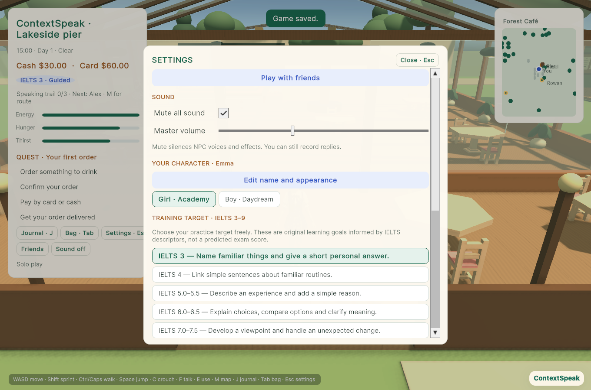
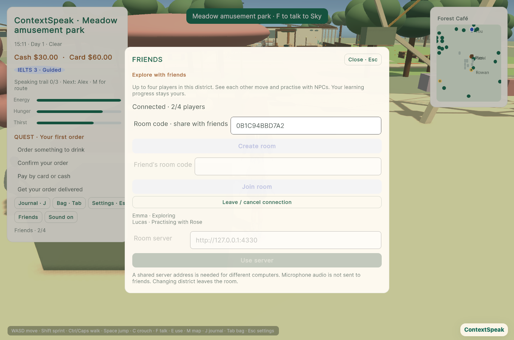
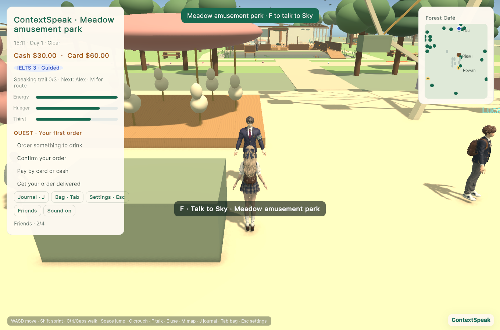

# Sound settings and friend rooms

## Use the game

In Forest Café, open **Settings → Sound** for master mute and volume. The HUD also
has **Sound on/off**. Preferences apply across districts and restarts. Mute affects
NPC speech, footsteps and ambience, while microphone recording and feedback remain
available.

Choose **Friends**, then **Create room**. Share its 12-character code; another
player selects **Join room**. Up to four players can explore the Forest Café
district, see each other's chosen character and movement, and see which NPC a
friend is practising with. NPC speech, recordings, assessments, wallet and quest
progress remain personal. The room does not broadcast microphone audio or merge
AI conversations. Leaving or changing district removes your avatar; inactive
connections expire after 60 seconds. Rejoining is explicit.

## Automatic local testing

```sh
pnpm world:dev
```

The existing loopback AI/web companion stays on `127.0.0.1:4320`. It now starts a
separate loopback room service on port `4330` automatically. Open two separate
browser profiles (or browser plus desktop) to test two players. Two ordinary tabs
in one profile share the same local learning save, so use separate profiles for
independent learning histories.

## Different computers

Every player must point to the **same reachable room server**. A room code alone
does not make a localhost server reachable from another computer. No public
hosting, firewall change or cloud account is provisioned by this feature.

For a trusted LAN, run the dedicated room service on the hosting computer:

```sh
CONTEXTSPEAK_ROOMS_HOST=0.0.0.0 pnpm world:rooms
```

Native players enter that computer's address, for example
`http://192.168.1.20:4330`, under **Friends → Room server → Use server**. Keep the
local AI companion running separately on each player's computer for private speech
practice. Do not expose port 4320 or forward it to the Internet.

For Internet play, host the room service behind a valid HTTPS reverse proxy. The
room process can stay loopback-only behind that proxy. On each browser player's
computer start the local companion with the shared endpoint:

```sh
CONTEXTSPEAK_ROOM_URL=https://rooms.example.com pnpm world:dev
```

This configures the game's room URL and browser CSP allowance together. The URL
above is a placeholder, not a deployed service. Native players can set that HTTPS
origin directly in Friends. If the game website uses an origin other than
`http://127.0.0.1:4320`, list its exact origin on the room host:

```sh
CONTEXTSPEAK_ROOM_ORIGINS=https://game.example.com pnpm world:rooms
```

Comma-separated origins are supported. Use HTTPS for public browser hosting and
microphone access. The browser endpoint is operator-configured in the companion,
not changed through an unrestricted client-side URL field.

## Boundaries and maintenance

This first version is private guest-room presence, not a globally hosted MMO.
Rooms live in one process's memory and disappear when it restarts. The server has
no AI, account, file, score or recording routes. Participant tokens are temporary,
stay out of public snapshots and are never written to game saves. Random room
codes invite joining; they do not authorize another player's identity or updates.

The service validates bounded JSON and transforms, isolates rooms, caps each room
at four players and the process at 100 active rooms, and enforces browser origins.
Use trusted networks/a restricted pilot deployment. Public-scale hosting would
also need account access controls, operating limits/monitoring and deployment
infrastructure. It does not provide shared physics, shared quest authority, PvP,
voice chat or a leaderboard.

Remote avatars use the prepared protagonist meshes and have no local camera,
controller, collider or quest ownership. Presence updates run up to five times per
second with interpolated motion. Static world objects and NPC schedules are still
simulated locally, so two clients can have different weather or NPC timing.

## Regression checks

```sh
pnpm test
pnpm typecheck
pnpm unity:test
pnpm unity:build:web
pnpm exec playwright test --config playwright.unity.config.ts
pnpm unity:build:mac
```

Room tests use real HTTP requests. Browser microphone tests use synthetic capture
with fixture transcription/feedback, verifying integration rather than live ASR
quality. The browser suite checks two separate clients, movement, NPC activity,
room exit, late create cancellation, mute persistence and recording while muted.

## Verified build (2026-11-13)

- 616 project regression tests and TypeScript check passed.
- Native audio listener/persistence, remote visual ownership, existing UI,
  navigation and interaction checks passed; Web and macOS builds succeeded.
- Full browser run passed 28/29; the remaining test read status before Unity's
  reload completed. Its explicit scene-ready wait fixed the harness, and all
  three affected audio/room tests passed on a fresh targeted run. Existing 26
  gameplay/browser regressions passed in the full run.
- Actual rendered peer geometry, names and room controls were visually inspected.
- Tested locally with two separate browser clients; Internet hosting and
  different-computer playback have not been provisioned or tested here.




