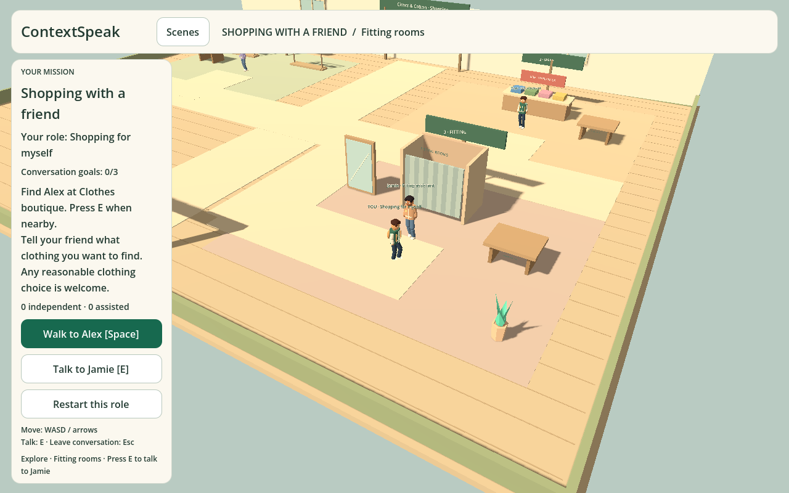
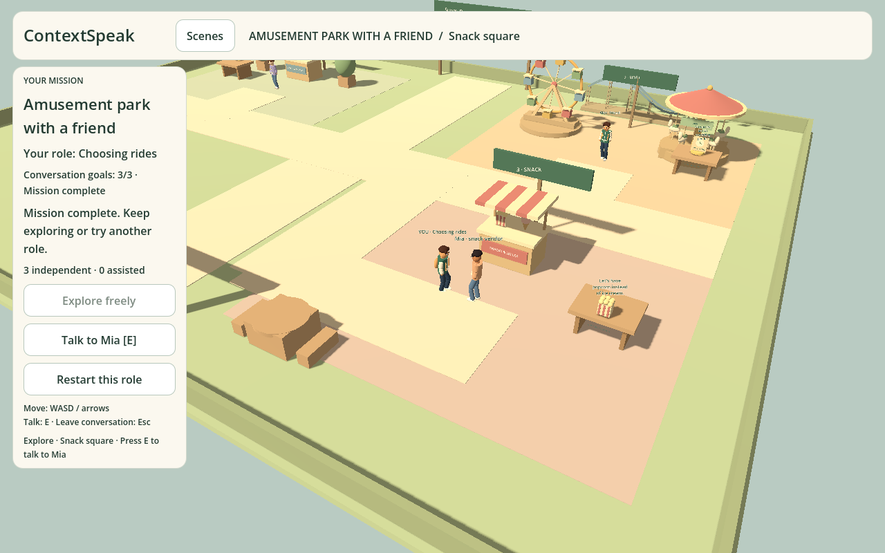
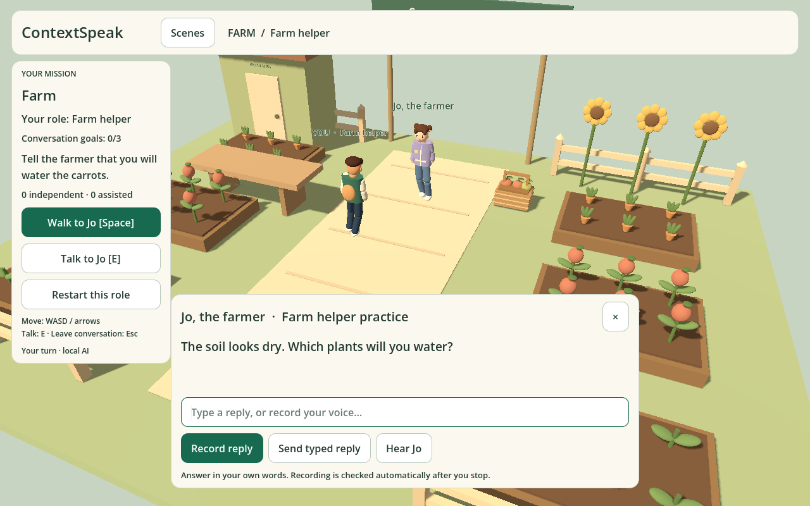
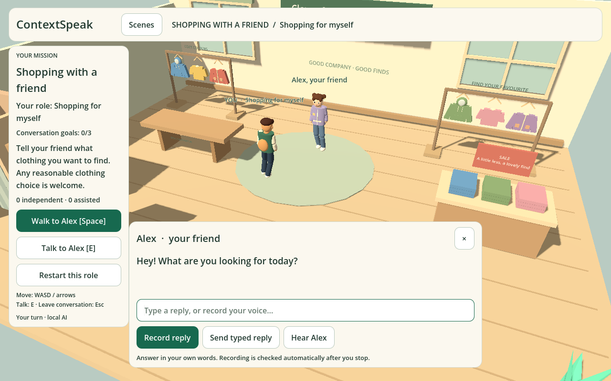
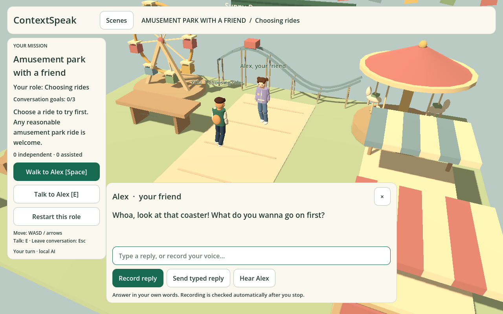

# Scene roleplay playtest — 10 November 2026

## Delivered slice

The original cafe journey remains intact. The Scenes menu offers five settings with two roles each and three authored goals per role:

| Setting | Learner roles | Visible task results |
| --- | --- | --- |
| Shopping with a friend | Shopping for myself; Helping a friend | Clothing/color choices, price discussion, fitting-room/bag cues |
| Farm | Farm helper; Farm shop customer | Watered soil, harvest, basket, eggs, cash |
| Market | Shopper; Fruit vendor | Authored apple quantities, paper bag, cash/card |
| Restaurant | Customer; Server | Reserved table, vegetable soup, bill |
| Amusement park with a friend | Choosing rides; Planning our day | Ride/plan cues, tickets, snacks and meeting points |

## Free exploration and NPC routes

Each roleplay map is now 36 × 28 metres with three connected areas and three
named, collidable NPCs. `scene_routes.json` owns their locations, safe helper
paths and area names; each lesson turn identifies its physical speaker.

- Start at the entrance without a dialogue panel. WASD/arrows move the learner;
  the camera follows. Space/Walk takes a collision-checked path to the next task
  actor. Manual steering cancels the helper; it never teleports or opens dialogue.
- Nearby E/Talk opens that actor's voiced line. Other actors offer greetings and
  directions, with reply controls disabled and clear instructions to keep exploring.
- A task stays at its actor while a correction is pending. Passing plays that
  actor's acknowledgement, then closes the panel and highlights the next stop.
  The old actor cannot ask the next speaker's question or accept remote replies.
- Escape/close cancels the microphone, audio and pending assessment. Returning
  to the scene restores completed effects and corrections at the right actor.
- All three goals complete into free exploration. Future/completed actor greetings
  never award progress. The original cafe journey and its save remain separate.

Real-user checks found two additional issues: exploration announcements lost the
independent/assisted count, and side greetings asked for a reply while those controls
were disabled. Both now retain consistent instructions and have regressions.

### Exploration checkpoint verification

- 422 TypeScript tests in 65 files, typecheck and formatting passed.
- All thirteen Godot scripts passed, including physical routes to all fifteen
  actors, proximity, pause/camera/helper cancellation and conversation lifecycle.
- Twelve unique browser regressions passed across the exploration and original
  café runs. Final checks include a synthetic recorded correction, both completed
  outings, busy/stale requests, saves and original café stage/recording controls.
  The optional live-model microphone suite was not rerun at this checkpoint.
- The final exported game passed another manual-WASD/side-greeting regression.
  The open in-app browser also reached a different area manually, greeted Jamie,
  walked back to Alex and triggered his local spoken question with E.
- Live authenticated local Qwen requests passed for shopping correction, the
  second shopping NPC and a restaurant order. No cloud request was used.
- Web/macOS export and extracted native headless startup passed. Full human
  microphone and native GUI testing remain pilot follow-ups.
- An independent source review found no Critical/Important issues. Its minor
  completed-greeting wording issue was fixed and pinned with a regression.

NPC questions play with cached local Phonon speech. Recording stops into local Whisper transcription and Qwen checking; typed answers use the same checker. Corrections require readback before the next goal. Readback normalizes case, punctuation, common contractions, spoken numbers and currency notation. A readback completion is labelled assisted; it is not an independent answer or a pronunciation score.

Completed goals create authored scene props and effects. AI output cannot select actions or award progress. Each role's guest save is separate from cafe progress and includes pending corrections. Changing scenes cancels prior microphone, voice and inference work. Restart affects only the selected role.

## Issues found and fixed

- Scene chooser keyboard focus could reach background controls. Explicit focus neighbours now keep Tab and Shift-Tab inside the menu; the cafe's disabled role selector cannot receive focus.
- Focused option text inherited a light color on the cream background. Focus and popup colors now remain legible.
- Client readback rejected “We'll” for “We will” and “$10” for “ten dollars.” Normalization and regression cases cover both.
- Repeated action names could conceal later completed goals. Action identities now include the authored step, remain idempotent on restore and use the accepted friend-scene answer for choice-specific props and the authored sample for fixed-goal scenes.
- The vendor's two-apple answer initially showed three apples. The effect now renders the authored quantity.
- The original test runner's 300-frame cap ended the new four-scene physics test early. This test now exits itself after exercising all scenes.

## Earlier guided-lesson verification

- Full TypeScript suite: 65 files, 408 tests passed; typecheck and Prettier check passed.
- Eleven Godot headless scripts passed, including all five scene movement/collision/action checks to completion.
- Real local Qwen smoke cases: correct answer, grammar error requiring correction, unrelated reply, natural shopping/payment phrases and prompt injection. Expected outcomes passed.
- Actual local Phonon → Whisper → Qwen pipeline: generated “I'm looking for a red jacket.”, transcribed the sentence correctly and accepted its shopping goal. This was synthetic speech, not a human microphone recording.
- Web and macOS exports succeeded. The extracted macOS app started headlessly and exited 0 without script errors. Native startup and browser rendering cover the updated game; full human microphone/desktop GUI validation remains a pilot follow-up.
- Final exported-build browser suite: all five outing regressions passed in 2.9 minutes. Coverage includes all ten role selections and voiced first questions, recorded correction readback, assisted/independent completion, separate role saves, pending correction after reload, busy-provider fallback, stale-result cancellation and a full park conversation with casual replies.

## Practical limits

This is ten short guided lessons, not unrestricted simulation or a complete curriculum. Word checking and grammar feedback depend on local transcription and a small local model; the transcript can be edited if recognition is wrong. The initial exact-word readback is not acoustic pronunciation assessment. New roleplay progress remains device-only and is not synchronized to account Dashboard scores. The downloadable macOS prototype still needs the local companion and installed models; it is not a self-contained offline installer. A fresh human microphone and packaged desktop GUI playtest remain appropriate before a pilot.

## Free asset provenance

See `games/cafe/assets/CREDITS.md`, pinned `sources.json`, and `docs/FREE_3D_ASSETS.md`. This expansion reuses already-verified CC0 files and adds original procedural geometry; no paid extras or source files were imported.

## Browser captures

## Friend-outing update

School is replaced by shopping with a friend; amusement park is added. New scene IDs keep old school progress from becoming completed shopping lessons. New friend prompts use casual English, contractions and short replies. Meaning checks accept reasonable alternative clothing, colors, rides, food and plans, including negative preferences. The fixed goals and examples for farm/market/restaurant remain, with more conversational NPC wording.

Actual learner choices drive friend-scene effects and survive role restore. Casual readback normalization also accepts “let us/let’s,” “that is/that’s” and “want to/wanna.” The totals above reflect the final outing regression run.

### Final review fixes

Reviewed choices now preserve negated/alternative rides and snacks, Unicode apostrophes, declined fitting-room choices and accepted ticket counts. Unsupported clothing or landmarks use neutral labelled cues instead of inventing a hoodie or entrance. Two independent code reviews covered backend choice/meaning preservation and Godot scene/save/effect integration; material findings were pinned with regressions.

- Live authenticated companion HTTP checks passed for shopping grammar repair and a casual carousel choice; retired school requests return400.
