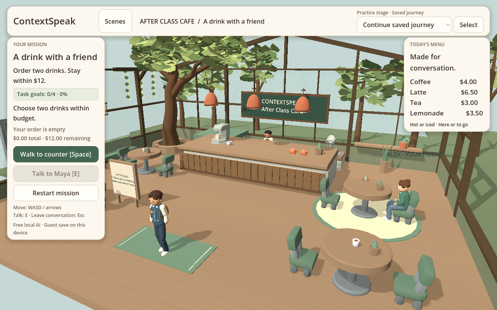
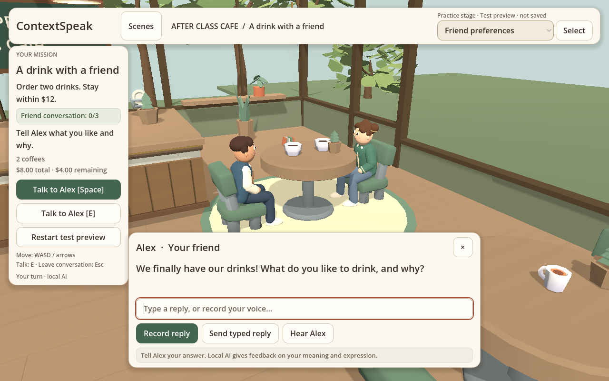
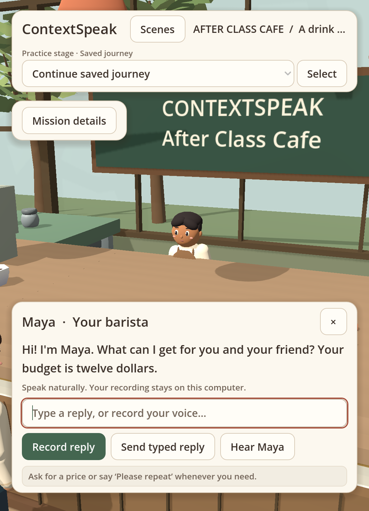

# Forest café visual QA

final result: passed

## Updated target: forest conservatory

The newest user reference is `/Users/elaineting/Downloads/森林咖啡馆游戏场景概念板.png`.
Its forest-conservatory mood guides the existing playable Godot scene. The
board's menu, NPC catalog and decorative inventory are not new gameplay rules.
The original two-NPC café journey and connected role scenes remain intact.

### Rendered comparison and repairs

Compare the reference with `docs/playtest/forest/final-cafe-overview.png`,
`final-cafe-counter.png` and `final-cafe-friend-dialogue.png`. The implementation
uses real geometry: curved tree and planter bench, tall timber glazing, rear
truss, brass lanterns, counter joinery, vines and an outside garden. Sage seating,
cream/brown barista clothing, navy learner clothing and the friend's sage
cardigan share its palette. The room stays a compact stylized low-poly scene;
it does not reproduce the board's high-detail illustration or add a mezzanine,
new customers, menu items or accessible garden.

- First-pass foliage was sparse and spiky; broad folded leaves, denser grouped
  canopies and a lighter daylight background resolved that visual finding.
- The high fixed exploration view felt distant. The lower view now follows
  gently; a corner test caught overlap with the desktop HUD. Stronger horizontal
  following and aspect-dependent framing keep the learner visible at the room
  corners in 1280×800, 800×800 and 573×793 views. Dialogue cameras stay pinned.
- The seated view exposed an empty far-right window. Garden ground and one
  shared-geometry tree now continue that backdrop. A new regression failed
  before the fix and passes within the original 12,000-triangle botany budget.
- Active counter and seated dialogue keep faces visible, reply/record/replay
  controls reachable and the original narrow Mission details disclosure intact.

### Forest verification

- All 16 Godot suites pass, including routes, camera sphere/visual clearance,
  frame-rate-independent damping, reduced motion, UI input and all role scenes.
- The forest has 25 botanical mesh/group nodes, 1,212 opaque leaves in six
  groups, 11,844 drawn triangles, ten shared meshes and nine shared materials.
  The complete café has 263 visible mesh/group nodes, 274 surfaces and 74,438
  indexed triangles; environment resources are 34 materials / 54 geometries.
  There are six lights, exactly one shadow caster and three glass panes.
- Real native GL validates the leaf transform buffers and culling bounds. A
  separate 120-frame render sample at 1280×800 held the 60fps cap on this Apple
  M5, averaging 540 draw calls. This is not a guarantee for another GPU/browser.
- The exported café browser regressions pass all eight cases: voiced ordering,
  friend completion, budget correction, synthetic recording/automatic submit,
  failure recovery, stale replies, stage-preview save isolation and responsive
  controls. After the final backdrop refinements, the exported desktop visual
  smoke passed again; the 573×793 DPR2 visual check also passed.
- 422 TypeScript tests / 65 files, typecheck, formatting and asset tamper checks
  passed. All 41 pinned CC0 asset/license files verify. Five gameplay/content
  hashes still match. Independent source review found no remaining garden or
  architecture issue; the latest camera changes were checked with runtime cases.
- Browser captures include 1280×800 DPR1 and 573×793 DPR2. In-app captures show
  actual local NPC audio reaching Your turn and restored saved friend progress.
  Synthetic microphone tests do not establish human recognition accuracy.

The earlier cozy checkpoint below records the retained UI/input fixes and the
broader role-scene browser pass. Full-phone support below 573 CSS pixels and a
complete packaged native microphone/usability session are not claimed.

## Retained input and interface repairs

The earlier cozy pass fixed issues observed in real renders and interactions:

- Filtered the repeating floor grain/seams to remove distance aliasing.
- Replaced the narrow full-width mission overlay with a compact disclosure,
  keeping NPC faces visible and every existing action available.
- Gave long speech/feedback keyboard-scroll targets, visible focus and
  Home/Down/End coverage while retaining reply → record Tab order.
- Fixed Escape from the focused reply field, verified failing before the fix.
- Raised expanded Mission details in both drawing and input order so Restart
  remains clickable above long dialogue; a real mouse event pins the repair.

The broader cozy checkpoint passed 14 browser cases, with one optional live-model
microphone case skipped. It covered all ten role selections, independent and
assisted completion, recorded correction, busy/stale work, saves and café flow.
The later forest checks above cover the changed environment, outfits and camera.

## Performance and test limits

Resource counts do not establish frame rate. The native GPU sample is separate
from Chromium's short software-rendered presentation sample, approximately
8.6fps (`docs/playtest/forest/final-presentation-cadence.json`). The software test
browser remains slow; no browser speed improvement is claimed. A real hardware-
accelerated browser/device performance pass is still needed before a pilot.

Web and macOS exports succeeded. The final extracted macOS package started
headlessly and exited 0; native GL rendering was checked separately. This is
not a complete packaged native GUI or human microphone playtest. The desktop
client still requires the local companion and models.

Remaining P3 layout refinement: in the narrow closed-dialogue seated view, the
compact mission summary can overlap the top of Alex's hair. Active dialogue
hides that summary and leaves the face visible. Full-phone layouts below
573 CSS pixels are not claimed. No remaining P0/P1/P2 functional finding was
observed in the tested flows.

## Accepted screenshots

Original cozy baselines/fix evidence remain under `docs/playtest/cozy`; forest
first-pass and final evidence is under `docs/playtest/forest`. Desktop captures
are 1280×800 DPR1, narrow browser captures are 573×793 CSS at DPR2; in-app outputs
are 573×793 pixels. The user reference guided original 3D art direction, not a
pixel-exact screenshot clone.

